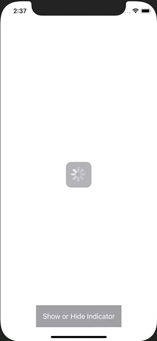

+++
title =  "SwiftUIで少しカスタマイズしたActivityIndicatorを表示する"
url = "2021-05-08"
date = "2021-05-08"
description = "SwiftUIで少しカスタマイズしたActivityIndicatorを表示する"
tags = ["Swift", "SwiftUI"]
categories = ["SwiftUI"]
archives = "2021/05"
+++

<br>

SwiftUIで少しカスタマイズしたActivityIndicatorを表示する方法です。背景色をつけたActivityIndicatorを表示したり隠したりしています。



<!-- Google Ads -->


<!-- Amazon Ads -->


<!--more-->

**ActivityIndicator.swift**

```swift
import SwiftUI

struct ActivityIndicator: UIViewRepresentable {
    func makeUIView(context: UIViewRepresentableContext<ActivityIndicator>) -> UIActivityIndicatorView {
        return UIActivityIndicatorView(style: .large)
    }
    func updateUIView(_ uiView: UIActivityIndicatorView, context: UIViewRepresentableContext<ActivityIndicator>) {
        uiView.color = UIColor.white
        uiView.style = .large
        uiView.startAnimating()
    }
}

struct CustomActivityIndicator: View {
    var body: some View {
        ActivityIndicator()
            .padding(12)
            .background(Color.gray.opacity(0.8))
            .cornerRadius(12)
    }
}
```


**ContentView.swift**

```swift
import SwiftUI

struct ContentView: View {
    @State var showingIndicator = true
    
    var body: some View {
        ZStack {
            VStack {
                Spacer()
                Button {
                    showingIndicator.toggle()
                } label: {
                    Text("Show or Hide Indicator")
                        .foregroundColor(Color.white)
                        .padding()
                        .background(Color.gray)
                }
            }
            
            if showingIndicator {
                CustomActivityIndicator()
            }
        }
    }
}

struct ContentView_Previews: PreviewProvider {
    static var previews: some View {
        ContentView()
    }
}
```


