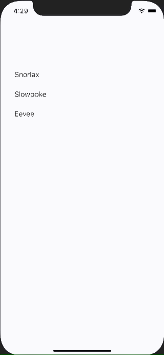

+++
title =  "SwiftUIでListにButtonを設定してパラメーターの違う画面に遷移する"
url = "2021-05-09"
date = "2021-05-09"
description = "SwiftUIでListにButtonを設定してパラメーターの違う画面に遷移する"
tags = ["Swift", "SwiftUI"]
categories = ["SwiftUI"]
archives = "2021/05"
+++

<br>

SwiftUIでListにButtonを設定してパラメーターの違う画面に遷移する方法です。
詳細ページに遷移するような使い方を想定しています。



<!-- Google Ads -->


<!-- Amazon Ads -->


<!--more-->

**ContentView.swift**

```swift
import SwiftUI

struct ContentView: View {
    @State var isActive : Bool = false
    @State var pokemonName: String = ""
    
    var body: some View {
        NavigationView {
            VStack {
                List {
                    Button {
                        pokemonName = "Snorlax"
                        isActive = true
                    } label: {
                        Text("Snorlax")
                    }
                    Button {
                        pokemonName = "Slowpoke"
                        isActive = true
                    } label: {
                        Text("Slowpoke")
                    }
                    Button {
                        pokemonName = "Eevee"
                        isActive = true
                    } label: {
                        Text("Eevee")
                    }
                }
                NavigationLink(
                    destination: Text(pokemonName),
                    isActive: $isActive
                ) {
                    EmptyView()
                }
            }
        }
    }
}

struct ContentView_Previews: PreviewProvider {
    static var previews: some View {
        ContentView()
    }
}
```


