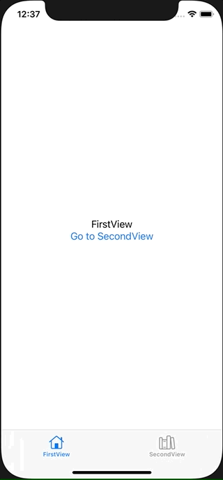

+++
title =  "SwiftUIのTabViewのタブをコードから動的に切り替える"
url = "2021-06-01"
date = "2021-06-01"
description = "SwiftUIのTabViewのタブをコードから動的に切り替える"
tags = ["Swift", "SwiftUI"]
categories = ["SwiftUI"]
archives = "2021/06"
+++

<br>

SwiftUIのTabViewのタブをコードから動的に切り替える方法です。
コードで動的にタブを切り替える方法です

参考: [Programmatically change to another tab in SwiftUI](https://stackoverflow.com/questions/62504400/programmatically-change-to-another-tab-in-swiftui)



<!-- Google Ads -->


<!-- Amazon Ads -->


<!--more-->

**ContentView.swift**

```swift
import SwiftUI

struct ContentView: View {
    @State var tabSelection: Int = 0
    var body: some View {
        TabView(selection: $tabSelection) {
            FirstView(tabSelection: $tabSelection)
                .tabItem {
                    Image(systemName: "house")
                        .renderingMode(.template)
                    Text("FirstView")
                }
                .tag(0)
            SecondView(tabSelection: $tabSelection)
                .tabItem {
                    Image(systemName: "books.vertical")
                        .renderingMode(.template)
                    Text("SecondView")
                }
                .tag(1)
        }
    }
}

struct FirstView: View {
    @Binding var tabSelection: Int
    var body: some View {
        VStack {
            Text("FirstView")
            Button {
                tabSelection = 1
            } label: {
                Text("Go to SecondView")
            }
        }
    }
}

struct SecondView: View {
    @Binding var tabSelection: Int
    var body: some View {
        VStack {
            Text("SecondView")
            Button {
                tabSelection = 0
            } label: {
                Text("Go to FirstView")
            }
        }
    }
}

struct ContentView_Previews: PreviewProvider {
    static var previews: some View {
        ContentView()
    }
}
```

