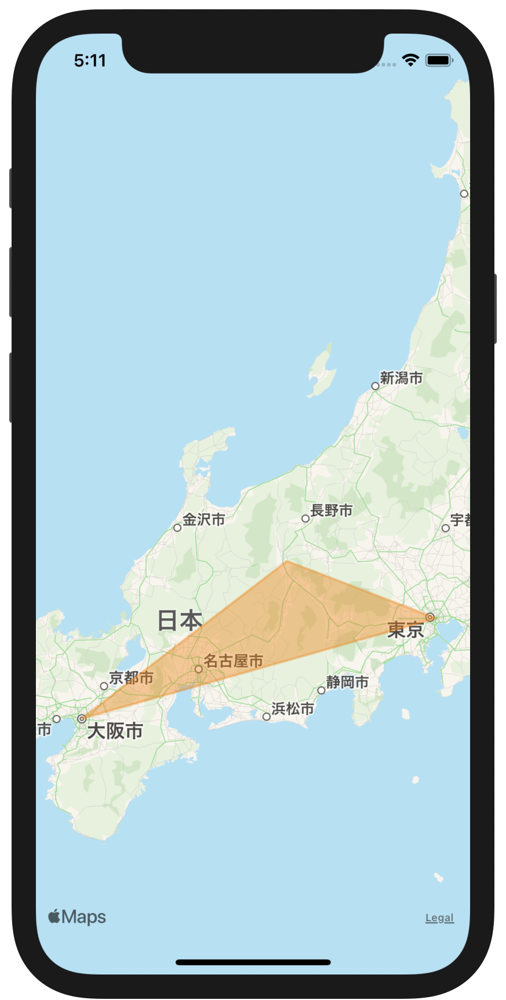

+++
title =  "iOSでMKMapViewの上に図形を描画する"
url = "2021-07-01"
date = "2021-07-01"
description = "iOSでMKMapViewの上に図形を描画する"
tags = ["iOS", "Swift", "UIKit"]
categories = ["Swift"]
archives = "2021/07"
+++

<br>

iOSのMKMapViewの上に図形を描画する方法です。
`MKPolygon` を使うことで任意の多角形を描画することができます。

<!--more-->

**ViewController.swift**

```swift
import UIKit
import MapKit

class ViewController: UIViewController {
    override func viewDidLoad() {
        super.viewDidLoad()
        
        let mapView = MKMapView()
        mapView.frame = view.bounds
        mapView.delegate = self
        view.addSubview(mapView)
        
        let coordinates: [CLLocationCoordinate2D]  = [
            CLLocationCoordinate2D(latitude: 35.6804, longitude: 139.7690),
            CLLocationCoordinate2D(latitude: 36.2380, longitude: 137.9720),
            CLLocationCoordinate2D(latitude: 34.6937, longitude: 135.5023),
        ]
        
        let polygon = MKPolygon(coordinates: coordinates, count: coordinates.count)
        mapView.addOverlay(polygon)
    }
}

extension ViewController: MKMapViewDelegate {
    func mapView(_ mapView: MKMapView, rendererFor overlay: MKOverlay) -> MKOverlayRenderer {
        if let polygone = overlay as? MKPolygon {
            let polylineRenderer = MKPolygonRenderer(polygon: polygone)
            polylineRenderer.strokeColor = .orange
            polylineRenderer.lineWidth = 2.0
            polylineRenderer.fillColor = .orange
            polylineRenderer.alpha = 0.4
            return polylineRenderer
        }
        return MKOverlayRenderer()
    }
}
```


<!-- Amazon Ads -->


<!-- Google Ads -->



