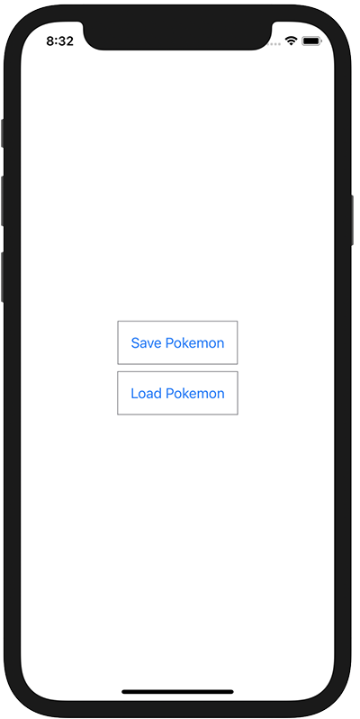

+++
title =  "自分で定義したStructをUserDefaultsに保存する"
url = "2021-07-03"
date = "2021-07-03"
description = "自分で定義したStructをUserDefaultsに保存する"
tags = ["Swift", "SwiftUI"]
categories = ["SwiftUI"]
archives = "2021/07"
+++

<br>

自分で定義したStructをUserDefaultsに保存する方法です。
そのままでは保存することができないので、一度 JSONEncoder で Data に保存してから保存します。



<!-- Amazon Ads -->


<!-- Google Ads -->


<!--more-->

**ContentView.swift**

```swift
import SwiftUI

struct Pokemon: Codable {
    let name: String
    let type: String
}

struct ContentView: View {
    var body: some View {
        VStack {
            Button {
                let pokemon: Pokemon = Pokemon(name: "Snorlax", type: "Normal")
                if let data: Data = try? JSONEncoder().encode(pokemon) {
                    UserDefaults.standard.setValue(data, forKey: "POKEMON")
                }
            } label: {
                Text("Save Pokemon")
                    .padding()
                    .border(Color.gray, width: 1)
            }
            
            Button {
                if let data: Data = UserDefaults.standard.value(forKey: "POKEMON") as? Data,
                   let pokemon: Pokemon = try? JSONDecoder().decode(Pokemon.self, from: data) {
                    print(pokemon)
                }
            } label: {
                Text("Load Pokemon")
                    .padding()
                    .border(Color.gray, width: 1)
            }
        }
    }
}

struct ContentView_Previews: PreviewProvider {
    static var previews: some View {
        ContentView()
    }
}
```

