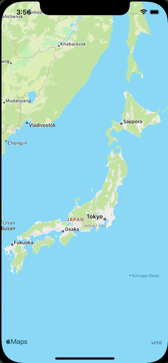

+++
title =  "MapViewのタップした箇所に黒丸を描画する"
url = "2021-10-01"
date = "2021-10-01"
description = "MapViewのタップした箇所に黒丸を描画する"
tags = ["iOS", "Swift", "UIKit"]
categories = ["iOS"]
archives = "2021/10"
+++


<br>

MapViewのタップした箇所に黒丸を描画する方法です。
タップした箇所に黒丸を描画しています。黒丸のサイズは地図に対して相対的ではなく絶対的（地図を拡大すると黒丸も大きくなる）になります。
相対的なものにしたいときはMKPointAnnotationを使うと良いかもしれません。



<!-- Amazon Ads -->


<!-- Google Ads -->


<!--more-->

**ViewController.swift**

```swift
import UIKit
import MapKit

class ViewController: UIViewController {
    let mapView = MKMapView()

    override func viewDidLoad() {
        super.viewDidLoad()
  
        let tapGestureRecognizer = UITapGestureRecognizer()
        tapGestureRecognizer.addTarget(self, action: #selector(onTap(sender:)))
        
        mapView.addGestureRecognizer(tapGestureRecognizer)
        mapView.frame = view.bounds
        mapView.delegate = self
        view.addSubview(mapView)
    }

    @objc func onTap(sender: UITapGestureRecognizer) {
        let tapPoint = sender.location(in: mapView)
        let location = mapView.convert(tapPoint, toCoordinateFrom: mapView)
        
        let circle = MKCircle(center: location, radius: 10000)
        mapView.addOverlay(circle)
    }
}

extension ViewController: MKMapViewDelegate {
    public func mapView(_ mapView: MKMapView, rendererFor overlay: MKOverlay) -> MKOverlayRenderer {
        if let circle = overlay as? MKCircle {
            let circleRenderer = MKCircleRenderer(circle: circle)
            circleRenderer.strokeColor = .black
            circleRenderer.fillColor = .black
            circleRenderer.lineWidth = 2.0
            return circleRenderer
        }
        return MKOverlayRenderer()
    }
}
```


