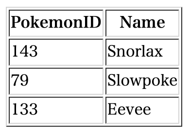

+++
title =  "Golangでtext/templateを使ってhtmlファイルを生成する"
url = "2021-10-02"
date = "2021-10-02"
description = "Golangでtext/templateを使ってhtmlファイルを生成する"
tags = ["Go"]
categories = ["Go"]
archives = "2021/10"
+++


<br>

Golangでtext/templateを使ってhtmlファイルを生成する方法です。
Pokemon構造体の配列を作成し、一覧表示する htmlファイル（index.html）を作成しています。



<!-- Amazon Ads -->


<!-- Google Ads -->


<!--more-->

**index.html**

```html
<!DOCTYPE html>
<html lang="ja">
  <head>
    <meta charset="UTF-8">
  </head>
  <body>
    <table border="1">
      <tr>
        <th>PokemonID</th>
        <th>Name</th>
      </tr>

<!-- Loop Start -->
<tr>
<td>143</td>
<td>Snorlax</td>
</tr><tr>
<td>79</td>
<td>Slowpoke</td>
</tr><tr>
<td>133</td>
<td>Eevee</td>
</tr>
<!-- Loop End -->

    </table>
  </body>
</html>
```


**index.html.tmpl**

```gotemplate
<!DOCTYPE html>
<html lang="ja">
  <head>
    <meta charset="UTF-8">
  </head>
  <body>
    <table border="1">
      <tr>
        <th>PokemonID</th>
        <th>Name</th>
      </tr>

<!-- Loop Start -->
{{ range $i, $pokemon := . -}}
<tr>
<td>{{ $pokemon.Id }}</td>
<td>{{ $pokemon.Name }}</td>
</tr>
{{- end }}
<!-- Loop End -->

    </table>
  </body>
</html>
```


**main.go**

```go
package main

import (
	"log"
	"os"
	"text/template"
)

type Pokemon struct {
	Id   int
	Name string
}

func main() {
	// Pokemons
	pokemons := []Pokemon{
		{
			Id:   143,
			Name: "Snorlax",
		},
		{
			Id:   79,
			Name: "Slowpoke",
		},
		{
			Id:   133,
			Name: "Eevee",
		},
	}

	// load template file
	template, err := template.New("index.html.tmpl").ParseFiles("index.html.tmpl")
	if err != nil {
		log.Fatal(err)
	}

	// create file
	fp, err := os.Create("index.html")
	if err != nil {
		log.Println("error creating file", err)
	}
	defer fp.Close()

	// write file
	if err = template.Execute(fp, pokemons); err != nil {
		log.Fatal(err)
	}
}
```


