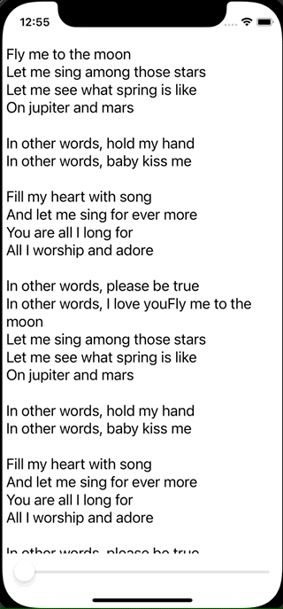

+++
title =  "SwiftUIでスライダーとスクロールを連動させる"
url = "2021-11-02"
date = "2021-11-02"
description = "SwiftUIでスライダーとスクロールを連動させる"
tags = ["iOS", "Swift", "SwiftUI"]
categories = ["iOS", "SwiftUI"]
archives = "2021/11"
+++

<br>

SwiftUIでスライダーとスクロールを連動させる方法です。
スライダーの値を変えることでScrollViewのスクロールを動かしています。



<!-- Amazon Ads -->


<!-- Google Ads -->


<!--more-->

**ContentView.swift**

```swift
import SwiftUI

struct ContentView: View {
    @State var percent: Double = 0
    let text = """
        Fly me to the moon
        Let me sing among those stars
        Let me see what spring is like
        On jupiter and mars
        
        In other words, hold my hand
        In other words, baby kiss me
        
        Fill my heart with song
        And let me sing for ever more
        You are all I long for
        All I worship and adore
        
        In other words, please be true
        In other words, I love you
        """
    
    var body: some View {
        VStack {
            TextScrollView(text: text + text + text + text, percent: $percent)
            Slider(value: $percent, in: 0...100)
                .padding(.horizontal)
        }
    }
}
```


**TextScrollView.swift**

```swift
import SwiftUI

public class UITextScrollView: UIView {
    private lazy var scrollView = UIScrollView()
    private lazy var textView = UITextView()
    
    required init?(coder aDecoder: NSCoder) {
        super.init(coder: aDecoder)
    }
    
    override init(frame: CGRect) {
        super.init(frame: frame)
        
        scrollView.backgroundColor = .white
        scrollView.isUserInteractionEnabled = false
        addSubview(scrollView)
        
        textView.textColor = UIColor.black
        textView.font = UIFont.systemFont(ofSize: 20)
        textView.isEditable = false
        
        scrollView.addSubview(textView)
    }
    
    public override func layoutSubviews() {
        scrollView.frame = frame
        let textViewSize = textView.sizeThatFits(CGSize(width: frame.size.width, height: 0))
        textView.frame.size = textViewSize
        scrollView.contentSize = textViewSize
    }
    
    func setText(text: String) {
        textView.text = text
    }
    
    func setContentOffset(percent: Double) {
        let contentHeight = scrollView.contentSize.height
        let frameHeight = scrollView.bounds.height
        if contentHeight < frameHeight {
            return
        }
        
        let diff = contentHeight - frameHeight
        let offset = diff * percent / 100
        scrollView.setContentOffset(CGPoint(x: 0.0, y: offset), animated: true)
    }
}

struct TextScrollView: UIViewRepresentable {
    let text: String
    @Binding var percent: Double

    func makeUIView(context: Context) -> UITextScrollView {
        let textScrollView = UITextScrollView()
        textScrollView.setText(text: text)
        return textScrollView
    }
    
    func updateUIView(_ uiView: UITextScrollView, context: Context) {
        uiView.setContentOffset(percent: percent)
    }
}
```

