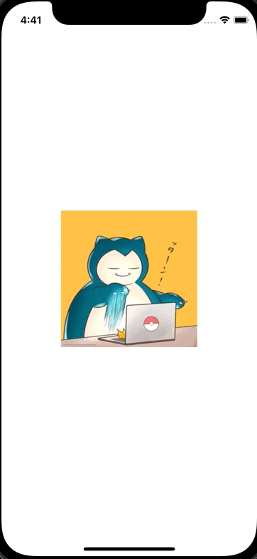

+++
title =  "UIKitのScrollViewでページングを実装する"
url = "2021-11-04"
date = "2021-11-04"
description = "UIKitのScrollViewでページングを実装する"
tags = ["iOS", "Swift", "UIKit"]
categories = ["iOS", "UIKit"]
archives = "2021/11"
+++

<br>

UIKitのScrollViewでページングを実装する方法です。
スクロールすると切り替わるタイミングでピタッと止まります。



<!-- Amazon Ads -->


<!-- Google Ads -->


<!--more-->

**ViewController.swift**

```swift
import UIKit

class ViewController: UIViewController {
    override func viewDidLoad() {
        super.viewDidLoad()
        view.backgroundColor = .white

        let scrollView: UIScrollView = UIScrollView()
        scrollView.frame.size = CGSize(width: 200, height: 200)
        scrollView.center = view.center
        scrollView.isPagingEnabled = true
        scrollView.contentSize = CGSize(width: 800, height: 200)
        view.addSubview(scrollView)
        
        let pokemons = ["snorlax", "diglett", "quagsire", "slowpoke"]
        for (index, pokemon) in pokemons.enumerated() {
            let imageView = UIImageView()
            imageView.image = UIImage(named: pokemon)
            imageView.frame = CGRect(x: index * 200, y: 0, width: 200, height: 200)
            scrollView.addSubview(imageView)
        }
    }
}
```

