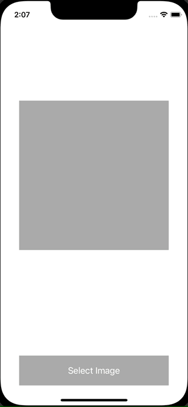

+++
title =  "PHPickerViewControllerを使って画像を選択する"
url = "2021-11-05"
date = "2021-11-05"
description = "PHPickerViewControllerを使って画像を選択する"
tags = ["iOS", "Swift", "UIKit"]
categories = ["iOS", "UIKit"]
archives = "2021/11"
+++

<br>

PHPickerViewController を使って画像を選択する方法です。
UIImagePickerController が将来的に非推奨になり PHPickerViewController に置き換わっていくみたいです。

参考: [Meet the new Photos picker](https://developer.apple.com/videos/play/wwdc2020/10652/)



<!-- Amazon Ads -->


<!-- Google Ads -->


<!--more-->

**ViewController.swift**

```swift
import UIKit
import PhotosUI

class ViewController: UIViewController {
    let imageView = UIImageView()

    override func viewDidLoad() {
        super.viewDidLoad()
        view.backgroundColor = .white
        
        let button = UIButton()
        button.setTitle("Select Image", for: .normal)
        button.backgroundColor = .lightGray
        button.frame = CGRect(x: (view.bounds.width - 300) / 2, y: view.bounds.height - 100, width: 300, height: 60)
        button.addTarget(self, action: #selector(showPicker), for: .touchUpInside)
        view.addSubview(button)
        
        imageView.backgroundColor = .lightGray
        imageView.frame = CGRect(x: (view.bounds.width - 300) / 2, y: 200, width: 300, height: 300)
        view.addSubview(imageView)
    }
    
    @objc func showPicker() {
        var configuration = PHPickerConfiguration()
        configuration.filter = .images
        configuration.selectionLimit = 1
        let picker = PHPickerViewController(configuration: configuration)
        picker.delegate = self
        present(picker, animated: true, completion: nil)
    }
}

extension ViewController: UINavigationControllerDelegate, PHPickerViewControllerDelegate {
    func picker(_ picker: PHPickerViewController, didFinishPicking results: [PHPickerResult]) {
        dismiss(animated: true, completion: nil)

        if let itemProvider = results.first?.itemProvider, itemProvider.canLoadObject(ofClass: UIImage.self) {
            itemProvider.loadObject(ofClass: UIImage.self) { [weak self] image, _ in
                guard let image = image as? UIImage else {
                    return
                }
                DispatchQueue.main.async {
                    self?.imageView.image = image
                }
            }
        }
    }
}
```

