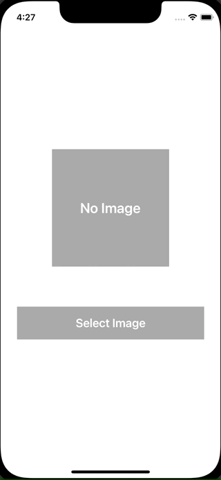

+++
title =  "SwiftUIでPHPickerViewControllerを使って画像を選択する"
url = "2021-11-09"
date = "2021-11-09"
description = "SwiftUIでPHPickerViewControllerを使って画像を選択する"
tags = ["Swift", "SwiftUI"]
categories = ["Swift", "SwiftUI"]
archives = "2021/11"
+++

<br>

SwiftUIでPHPickerViewControllerを使って画像を選択する方法です。
ImagePickerというクラスを使って実現しました。



<!-- Amazon Ads -->


<!-- Google Ads -->


<!--more-->

**ContentView.swift**

```swift
import SwiftUI

struct ContentView: View {
    @State var image: UIImage?
    @State var showingAlert: Bool = false
    
    var body: some View {
        VStack {
            if let image = image {
                Image(uiImage: image)
                    .resizable()
                    .frame(width: 200, height: 200)
            } else {
                Text("No Image")
                    .font(Font.system(size: 24).bold())
                    .foregroundColor(Color.white)
                    .frame(width: 200, height: 200)
                    .background(Color(UIColor.lightGray))
            }
            
            Button {
                showingAlert = true
            } label: {
                Text("Select Image")
                    .font(Font.system(size:20).bold())
                    .foregroundColor(Color.white)
                    .padding(.horizontal, 100)
                    .padding(.vertical, 16)
                    .background(Color(UIColor.lightGray))
            }
            .padding(.top, 60)
        }
        .sheet(isPresented: $showingAlert) {
            
        } content: {
            ImagePicker(image: $image)
        }
    }
}
```


**ImagePicker.swift**

```swift
import SwiftUI
import PhotosUI

struct ImagePicker: UIViewControllerRepresentable {
    @Environment(\.presentationMode) var presentationMode
    @Binding var image: UIImage?
    
    func makeCoordinator() -> Coordinator {
        Coordinator(self)
    }
    
    func makeUIViewController(context: UIViewControllerRepresentableContext<ImagePicker>) -> PHPickerViewController {
        var configuration = PHPickerConfiguration()
        configuration.filter = .images
        configuration.selectionLimit = 1
        let picker = PHPickerViewController(configuration: configuration)
        picker.delegate = context.coordinator
        return picker
    }
    
    func updateUIViewController(_ uiViewController: PHPickerViewController, context: UIViewControllerRepresentableContext<ImagePicker>) {}
    
    class Coordinator: NSObject, UINavigationControllerDelegate, PHPickerViewControllerDelegate {
        let parent: ImagePicker
        
        init(_ parent: ImagePicker) {
            self.parent = parent
        }
        
        func picker(_ picker: PHPickerViewController, didFinishPicking results: [PHPickerResult]) {
            parent.presentationMode.wrappedValue.dismiss()

            if let itemProvider = results.first?.itemProvider, itemProvider.canLoadObject(ofClass: UIImage.self) {
                itemProvider.loadObject(ofClass: UIImage.self) { [weak self] image, _ in
                    guard let image = image as? UIImage else {
                        return
                    }
                    DispatchQueue.main.sync {
                        self?.parent.image = image
                    }
                }
            }
        }
    }
}
```


