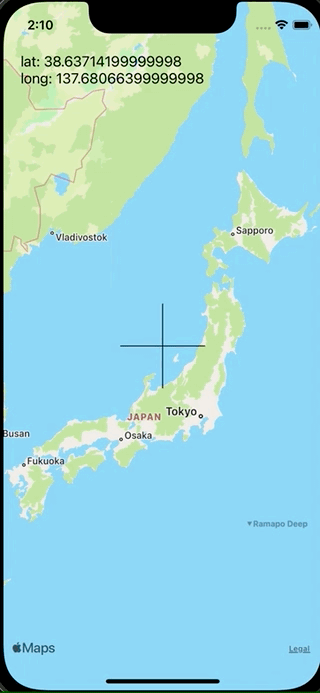

+++
title =  "SwiftでMapViewの中央に十字を用意し、その中央の座標を取得する"
url = "2021-11-12"
date = "2021-11-12"
description = "SwiftでMapViewの中央に十字を用意し、その中央の座標を取得する"
tags = ["iOS", "Swift", "UIKit"]
categories = ["iOS", "UIKit"]
archives = "2021/11"
+++

<br>

SwiftでMapViewの中央に十字を用意し、その中央の座標を取得する方法です。
スクロールしたりピンチしたタイミングで `regionDidChangeAnimated` が呼ばれるので、その時の中心の座標を取得しています。



<!-- Amazon Ads -->


<!-- Google Ads -->


<!--more-->

**ViewController.swift**

```swift
import UIKit
import MapKit

class ViewController: UIViewController {
    private lazy var latitudeLabel = UILabel()
    private lazy var longtitudeLabel = UILabel()
    
    override func viewDidLoad() {
        super.viewDidLoad()
        
        let mapView = MKMapView()
        mapView.frame = view.bounds
        mapView.delegate = self
        view.addSubview(mapView)
        
        let verticalLine = CAShapeLayer()
        let verticalLinePath = UIBezierPath()
        verticalLinePath.move(to: CGPoint(x: (view.bounds.width / 2) - 50, y: view.bounds.height / 2))
        verticalLinePath.addLine(to: CGPoint(x: (view.bounds.width / 2) + 50, y: view.bounds.height / 2))
        verticalLine.path = verticalLinePath.cgPath
        verticalLine.fillColor = nil
        verticalLine.opacity = 1.0
        verticalLine.strokeColor = UIColor.black.cgColor
        view.layer.addSublayer(verticalLine)
        
        let horizontalLine = CAShapeLayer()
        let horizontalLinePath = UIBezierPath()
        horizontalLinePath.move(to: CGPoint(x: view.bounds.width / 2, y: (view.bounds.height / 2) - 50))
        horizontalLinePath.addLine(to: CGPoint(x: view.bounds.width / 2, y: (view.bounds.height / 2) + 50))
        horizontalLine.path = horizontalLinePath.cgPath
        horizontalLine.fillColor = nil
        horizontalLine.opacity = 1.0
        horizontalLine.strokeColor = UIColor.black.cgColor
        view.layer.addSublayer(horizontalLine)
        
        latitudeLabel.textAlignment = .left
        latitudeLabel.frame = CGRect(x: 20, y: 60, width: 300, height: 20)
        view.addSubview(latitudeLabel)
        
        longtitudeLabel.textAlignment = .left
        longtitudeLabel.frame = CGRect(x: 20, y: 80, width: 300, height: 20)
        view.addSubview(longtitudeLabel)
        
        setLabelText(latitude: mapView.region.center.latitude, longitude: mapView.region.center.longitude)
    }
    
    private func setLabelText(latitude: Double, longitude: Double) {
        latitudeLabel.text = "lat: \(latitude)"
        longtitudeLabel.text = "long: \(longitude)"
    }
}

extension ViewController: MKMapViewDelegate {
    func mapView(_ mapView: MKMapView, regionDidChangeAnimated animated: Bool) {
        setLabelText(latitude: mapView.region.center.latitude, longitude: mapView.region.center.longitude)
    }
}
```

