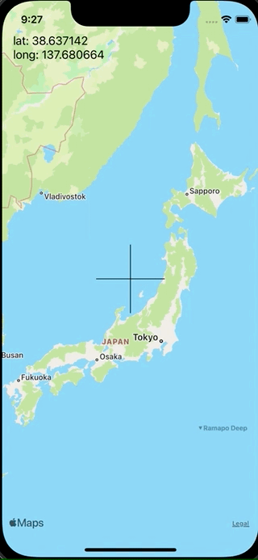

+++
title =  "SwiftUIでMapViewの中央に十字を用意し、その中央の座標を取得する"
url = "2021-12-05"
date = "2021-12-05"
description = "SwiftUIでMapViewの中央に十字を用意し、その中央の座標を取得する"
tags = ["Swift", "SwiftUI"]
categories = ["Swift", "SwiftUI"]
archives = "2021/12"
+++

<br>

SwiftUIでMapViewの中央に十字を用意し、その中央の座標を取得する方法です。
MapViewが動いたタイミングでラベルの文字列が更新されます。



<!-- Amazon Ads -->


<!-- Google Ads -->


<!--more-->

**ContentView.swift**

```swift
struct ContentView: View {
    @State private var latitude: Double = 0
    @State private var longitude: Double = 0
    
    var body: some View {
        ZStack(alignment: .topLeading) {
            LocationSelecterView() { location in
                latitude = location.latitude
                longitude = location.longitude
            }
            VStack(alignment: .leading) {
                Text("lat: \(latitude)")
                Text("long: \(longitude)")
            }
            .padding(.top, 48)
            .padding(.leading, 16)
        }
        .ignoresSafeArea(.all, edges: .all)
    }
}
```


**LocationSelecterView.swift**

```swift
import SwiftUI
import MapKit

public struct LocationSelecterView: UIViewRepresentable {
    let locationDidSet: (_ location: CLLocationCoordinate2D) -> Void
    final public class Coordinator: NSObject, LocationSelecterViewDelegate {
        private var mapView: LocationSelecterView
        let locationDidSet: (_ location: CLLocationCoordinate2D) -> Void
        
        init(_ mapView: LocationSelecterView, locationDidSet: @escaping (_ location: CLLocationCoordinate2D) -> Void) {
            self.mapView = mapView
            self.locationDidSet = locationDidSet
        }
        
        public func locationDidSet(location: CLLocationCoordinate2D) {
            locationDidSet(location)
        }
    }
    
    public func makeCoordinator() -> Coordinator {
        Coordinator(self, locationDidSet: locationDidSet)
    }
    
    public func makeUIView(context: Context) -> UILocationSelecterView {
        let locationsSelectView = UILocationSelecterView()
        locationsSelectView.delegate = context.coordinator
        return locationsSelectView
    }
    
    public func updateUIView(_ uiView: UILocationSelecterView, context: Context) {}
}
```


**UILocationSelecterView.swift**

```swift
import SwiftUI
import MapKit

public protocol LocationSelecterViewDelegate: AnyObject {
    func locationDidSet(location: CLLocationCoordinate2D)
}

public class UILocationSelecterView: UIView {
    public var locationLimit: Int?
    private lazy var mapView = MKMapView()
    weak public var delegate: LocationSelecterViewDelegate?
    
    private let verticalLine = CAShapeLayer()
    private let horizontalLine = CAShapeLayer()
    
    
    required init?(coder aDecoder: NSCoder) {
        super.init(coder: aDecoder)
    }
    
    override init(frame: CGRect) {
        super.init(frame: frame)
        
        mapView.delegate = self
        addSubview(mapView)
        
        verticalLine.fillColor = nil
        verticalLine.opacity = 1.0
        verticalLine.strokeColor = UIColor.black.cgColor
        layer.addSublayer(verticalLine)
        
        horizontalLine.fillColor = nil
        horizontalLine.opacity = 1.0
        horizontalLine.strokeColor = UIColor.black.cgColor
        layer.addSublayer(horizontalLine)
    }
    
    public override func layoutSubviews() {
        super.layoutSubviews()

        mapView.frame =  CGRect(x: 0, y: 0, width: bounds.width, height: bounds.height)
        
        let verticalLinePath = UIBezierPath()
        verticalLinePath.move(to: CGPoint(x: (bounds.width / 2) - 50, y: bounds.height / 2))
        verticalLinePath.addLine(to: CGPoint(x: (bounds.width / 2) + 50, y: bounds.height / 2))
        verticalLine.path = verticalLinePath.cgPath
        
        let horizontalLinePath = UIBezierPath()
        horizontalLinePath.move(to: CGPoint(x: bounds.width / 2, y: (bounds.height / 2) - 50))
        horizontalLinePath.addLine(to: CGPoint(x: bounds.width / 2, y: (bounds.height / 2) + 50))
        horizontalLine.path = horizontalLinePath.cgPath
    }
}

extension UILocationSelecterView: MKMapViewDelegate {
    public func mapView(_ mapView: MKMapView, regionDidChangeAnimated animated: Bool) {
        let location = CLLocationCoordinate2D(latitude: mapView.region.center.latitude, longitude: mapView.region.center.longitude)
        delegate?.locationDidSet(location: location)
    }
}
```


