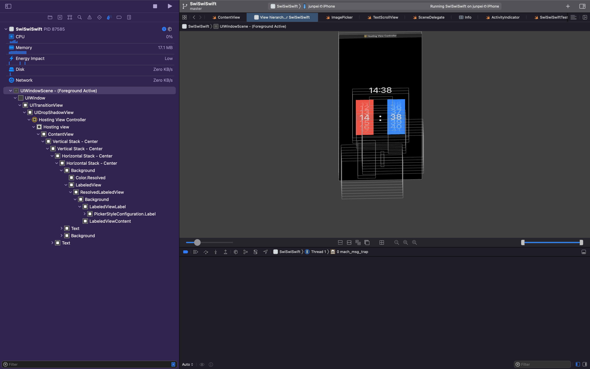
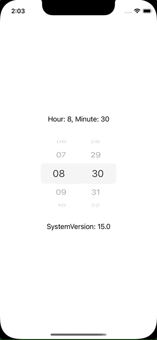

+++
title =  "iOS15でPickerを横に並べるとタップ領域が重なってしまう"
url = "2022-01-02"
date = "2022-01-02"
description = "iOS15でPickerを横に並べるとタップ領域が重なってしまう"
tags = ["Swift", "SwiftUI"]
categories = ["Swift", "SwiftUI"]
archives = "2022/01"
+++

<br>

iOS15でPickerを横に並べるとタップ領域が重なってしまう不具合に悩まされたのでその忘備録です。

以下の様なコードをiOS15の実機で実行し、左側の行を動かそうとすると右側の行が動いてしまいます。iOS14やシミュレーターでは問題なく動作します。

[Pickerを複数並べると.clip()を使ってもタップ領域が広がってしまうって問題です！](https://twitter.com/takoikatakotako/status/1478953308308271110)

<!--more-->

**ContentView.swift**

```swift
import SwiftUI

struct ContentView: View {
    @State private var hour: Int = 8
    @State private var minute: Int = 30
    
    var body: some View {
        VStack {
            Text("Hour: \(hour), Minute: \(minute)")
            TimePicker(hour: $hour, minute: $minute)
            Text("SystemVersion: \(UIDevice.current.systemVersion)")
        }
    }
}

```


**TimePicker.swift**

```swift
import SwiftUI

struct TimePicker: View {
    @Binding var hour: Int
    @Binding var minute: Int
    
    var body: some View {
        HStack {
            Picker(selection: $hour, label: EmptyView()) {
                ForEach(0 ..< 24) {
                    Text(String(format: "%02d", $0))
                        .font(Font.system(size: 42).bold())
                }
            }
            .labelsHidden()
            .frame(width: 80, height: 200)
            .pickerStyle(.wheel)
            .compositingGroup()
            .clipped()
            
            Text(":")
                .font(Font.system(size: 60).bold())
                .padding()
            
            Picker(selection: $minute, label: EmptyView()) {
                ForEach(0 ..< 60) {
                    Text(String(format: "%02d", $0))
                        .font(Font.system(size: 42).bold())
                }
            }
            .labelsHidden()
            .frame(width: 80, height: 200)
            .pickerStyle(.wheel)
            .compositingGroup()
            .clipped()
        }
    }
}
```


View Hierarchyを見たところ、タップ領域がclipされていないことが原因かと思われます。



Apple Developer Technical Support に助けを求めたところ「現時点では回避策がない既知の問題です。」と言われたので `UIViewRepresentable` を使って自分で作るしかなさそうです。



**ContentView.swift**

```swift
import SwiftUI

struct ContentView: View {
    @State private var hour: Int = 8
    @State private var minute: Int = 30
    
    var body: some View {
        VStack {
            Text("Hour: \(hour), Minute: \(minute)")
            TimePicker(hour: $hour, minute: $minute)
                .frame(width: 200)
            Text("SystemVersion: \(UIDevice.current.systemVersion)")
        }
    }
}
```


**TimePicker.swift**

```swift
import SwiftUI

struct TimePicker: UIViewRepresentable {
    var hour: Binding<Int>
    var minute: Binding<Int>
    
    func makeCoordinator() -> Coordinator {
        Coordinator(self)
    }
    
    func makeUIView(context: UIViewRepresentableContext<TimePicker>) -> UIPickerView {
        let picker = UIPickerView()
        picker.setContentCompressionResistancePriority(.defaultLow, for: .horizontal)
        
        picker.dataSource = context.coordinator
        picker.delegate = context.coordinator
        
        return picker
    }
    
    func updateUIView(_ view: UIPickerView, context: UIViewRepresentableContext<TimePicker>) {
        view.selectRow(hour.wrappedValue, inComponent: 0, animated: false)
        view.selectRow(minute.wrappedValue, inComponent: 1, animated: false)
    }
    
    class Coordinator: NSObject, UIPickerViewDataSource, UIPickerViewDelegate {
        var parent: TimePicker
        
        init(_ pickerView: TimePicker) {
            parent = pickerView
        }
        
        func numberOfComponents(in pickerView: UIPickerView) -> Int {
            return 2
        }
        
        func pickerView(_ pickerView: UIPickerView, numberOfRowsInComponent component: Int) -> Int {
            if component == 0 {
                return 24
            } else {
                return 60
            }
        }
        
        func pickerView(_ pickerView: UIPickerView, rowHeightForComponent component: Int) -> CGFloat {
            return 48
        }
        
        func pickerView(_ pickerView: UIPickerView, titleForRow row: Int, forComponent component: Int) -> String? {
            return String(format: "%02d", row)
        }
        
        func pickerView(_ pickerView: UIPickerView, didSelectRow row: Int, inComponent component: Int) {
            if component == 0 {
                parent.hour.wrappedValue = row
            } else {
                parent.minute.wrappedValue = row
            }
        }
    }
}
```

