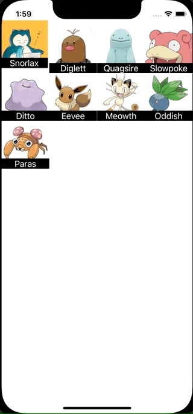

+++
title =  "UICollectionViewのセルを並び替える"
url = "2022-01-05"
date = "2022-01-05"
description = "UICollectionViewのセルを並び替える"
tags = ["iOS", "Swift", "UIKit", "Xcode"]
categories = ["Swift", "Xcode"]
archives = "2022/01"
+++

<br>

UICollectionViewのセルを並び替える方法です。
長押しすると移動できるようになります。

参考: [CollectionViewの並び替えを実装する | RE:ENGINES](https://re-engines.com/2019/11/14/collectionview%E3%81%AE%E4%B8%A6%E3%81%B3%E6%9B%BF%E3%81%88%E3%82%92%E5%AE%9F%E8%A3%85%E3%81%99%E3%82%8B/)



<!-- Amazon Ads -->


<!-- Google Ads -->


<!--more-->

**CustumCollectionViewCell.swift**

```swift
import UIKit

class CustumCollectionViewCell: UICollectionViewCell {
    lazy var textLabel = UILabel()

    required init(coder aDecoder: NSCoder) {
        super.init(coder: aDecoder)!
    }

    override init(frame: CGRect) {
        super.init(frame: frame)

        backgroundColor = .white

        textLabel = UILabel(frame: CGRect(x: 0, y: frame.height-20, width: frame.width, height: 20))
        textLabel.backgroundColor = UIColor.black
        textLabel.textAlignment = NSTextAlignment.center
        textLabel.textColor = UIColor.white
        contentView.addSubview(textLabel)
    }

    func setCell(name: String, imageName: String) {
        textLabel.text = name

        let image = UIImage(named: imageName)
        backgroundView = UIImageView(image: image)
    }
}
```


**Pokemon.swift**

```swift
import UIKit

struct Pokemon: Equatable {
    let name: String
    let imageName: String
}
```


**ViewController.swift**

```swift
import UIKit

class ViewController: UIViewController {
    var pokemons: [Pokemon] = [
        Pokemon(name: "Snorlax", imageName: "snorlax"),
        Pokemon(name: "Diglett", imageName: "diglett"),
        Pokemon(name: "Quagsire", imageName: "quagsire"),
        Pokemon(name: "Slowpoke", imageName: "slowpoke"),
        Pokemon(name: "Ditto", imageName: "ditto"),
        Pokemon(name: "Eevee", imageName: "eevee"),
        Pokemon(name: "Meowth", imageName: "meowth"),
        Pokemon(name: "Oddish", imageName: "oddish"),
        Pokemon(name: "Paras", imageName: "paras"),
    ]

    var collectionView : UICollectionView!

    override func viewDidLoad() {
        super.viewDidLoad()

        let viewWidth = view.frame.width
        let viewHeight = view.frame.height

        // CollectionView layout
        let layout = UICollectionViewFlowLayout()

        // cell size
        layout.itemSize = CGSize(width:viewWidth/4, height:viewWidth/4)

        // cell margin
        layout.sectionInset = UIEdgeInsets.zero

        // cell vertical margin
        layout.minimumInteritemSpacing = 0.0

        // cell horizontal margin
        layout.minimumLineSpacing = 0.0

        // section header size
        layout.headerReferenceSize = CGSize(width: 0, height: 0)

        // CollectionView
        let collectionFrame = CGRect(x: 0, y: 0, width: viewWidth, height: viewHeight)
        collectionView = UICollectionView(frame: collectionFrame, collectionViewLayout: layout)

        // register cell class
        collectionView.register(CustumCollectionViewCell.self, forCellWithReuseIdentifier: NSStringFromClass(CustumCollectionViewCell.self))

        collectionView.delegate = self
        collectionView.dataSource = self

        view.addSubview(collectionView)

        let longTapGesture = UILongPressGestureRecognizer(target: self, action: #selector(longTap(gesture:)))
        collectionView.addGestureRecognizer(longTapGesture)
    }

    @objc func longTap(gesture: UILongPressGestureRecognizer) {
        switch gesture.state {
        case .began:
            guard let selectedIndexPath = collectionView.indexPathForItem(at: gesture.location(in: collectionView)) else {
                break
            }
            collectionView.beginInteractiveMovementForItem(at: selectedIndexPath)
        case .changed:
            collectionView.updateInteractiveMovementTargetPosition(gesture.location(in: gesture.view))
        case .ended:
            collectionView.endInteractiveMovement()
        default:
            collectionView.cancelInteractiveMovement()
        }
    }
}

extension ViewController: UICollectionViewDelegate, UICollectionViewDataSource {
    func collectionView(_ collectionView: UICollectionView, didSelectItemAt indexPath: IndexPath) {
        print("section: \(indexPath.section), row: \(indexPath.row)")
    }

    func collectionView(_ collectionView: UICollectionView, numberOfItemsInSection section: Int) -> Int {
        return pokemons.count
    }

    func collectionView(_ collectionView: UICollectionView, cellForItemAt indexPath: IndexPath) -> UICollectionViewCell {
        let cell : CustumCollectionViewCell = collectionView.dequeueReusableCell(withReuseIdentifier: NSStringFromClass(CustumCollectionViewCell.self), for: indexPath) as! CustumCollectionViewCell
        let pokemon = pokemons[indexPath.row]
        cell.setCell(name: pokemon.name, imageName: pokemon.imageName)
        return cell
    }

    func collectionView(_ collectionView: UICollectionView, moveItemAt sourceIndexPath: IndexPath, to destinationIndexPath: IndexPath) {
        let item = pokemons.remove(at: sourceIndexPath.row)
        pokemons.insert(item, at: destinationIndexPath.row)
    }

    func collectionView(_ collectionView: UICollectionView, canMoveItemAt indexPath: IndexPath) -> Bool {
        return true
    }
}
```


