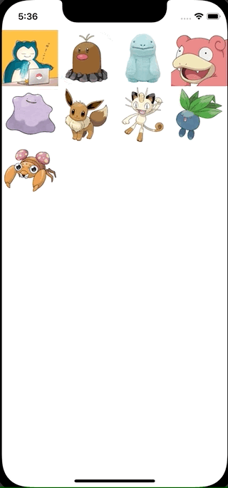

+++
title =  "CollectionViewで並び替え時に選択されたセルにアニメーションを付与する"
url = "2022-01-06"
date = "2022-01-06"
description = "CollectionViewで並び替え時に選択されたセルにアニメーションを付与する"
tags = ["iOS", "Swift", "UIKit", "Xcode"]
categories = ["Swift", "Xcode"]
archives = "2022/01"
+++

<br>

CollectionViewで並び替え時に選択されたセルにアニメーションを付与する方法です。
長押しすると移動できるようになります。

参考: [iOS – Longpress drag and drop using UICollectionView with Animation](https://mobikul.com/ios-longpress-drag-and-drop-using-uicollectionview-with-animation/)



<!-- Amazon Ads -->


<!-- Google Ads -->


<!--more-->

**CustumCollectionViewCell.swift**

```swift
import UIKit

class CustumCollectionViewCell: UICollectionViewCell {
    lazy var imageView: UIImageView = UIImageView()

    required init(coder aDecoder: NSCoder) {
        super.init(coder: aDecoder)!
    }

    override init(frame: CGRect) {
        super.init(frame: frame)

        backgroundColor = .white

        imageView.frame = self.bounds
        contentView.addSubview(imageView)
    }

    //Animation of image
    func startAnimate() {
        let shakeAnimation = CABasicAnimation(keyPath: "transform.rotation")
        shakeAnimation.duration = 0.05
        shakeAnimation.repeatCount = 4
        shakeAnimation.autoreverses = true
        shakeAnimation.duration = 0.2
        shakeAnimation.repeatCount = 99999

        let startAngle: Float = (-2) * 3.14159/180
        let stopAngle = -startAngle

        shakeAnimation.fromValue = NSNumber(value: startAngle as Float)
        shakeAnimation.toValue = NSNumber(value: 3 * stopAngle as Float)
        shakeAnimation.autoreverses = true
        shakeAnimation.timeOffset = 290 * drand48()

        let layer: CALayer = layer
        layer.add(shakeAnimation, forKey:"animate")
    }

    func stopAnimate() {
        let layer: CALayer = layer
        layer.removeAnimation(forKey: "animate")
    }
}
```


**ViewController.swift**

```swift
import UIKit

class ViewController: UIViewController {
    private var imageArray: [String] = ["snorlax", "diglett", "quagsire", "slowpoke", "ditto", "eevee", "meowth", "oddish", "paras"]
    private var collectionView : UICollectionView!

    override func viewDidLoad() {
        super.viewDidLoad()

        let viewWidth = view.frame.width
        let viewHeight = view.frame.height

        // CollectionView layout
        let layout = UICollectionViewFlowLayout()

        // cell size
        layout.itemSize = CGSize(width:viewWidth/4, height:viewWidth/4)

        // cell margin
        layout.sectionInset = UIEdgeInsets.zero

        // cell vertical margin
        layout.minimumInteritemSpacing = 0.0

        // cell horizontal margin
        layout.minimumLineSpacing = 0.0

        // section header size
        layout.headerReferenceSize = CGSize(width: 0, height: 0)

        // CollectionView
        let collectionFrame = CGRect(x: 0, y: 0, width: viewWidth, height: viewHeight)
        collectionView = UICollectionView(frame: collectionFrame, collectionViewLayout: layout)

        // register cell class
        collectionView.register(CustumCollectionViewCell.self, forCellWithReuseIdentifier: NSStringFromClass(CustumCollectionViewCell.self))

        collectionView.delegate = self
        collectionView.dataSource = self

        view.addSubview(collectionView)

        let longPressGesture = UILongPressGestureRecognizer(target: self, action: #selector(self.longTap(_:)))
        collectionView.addGestureRecognizer(longPressGesture)
    }

    @objc func longTap(_ gesture: UILongPressGestureRecognizer){
        switch(gesture.state) {
        case .began:
            guard let selectedIndexPath = collectionView.indexPathForItem(at: gesture.location(in: collectionView)) else {
                return
            }
            let cell = collectionView.cellForItem(at: selectedIndexPath) as? CustumCollectionViewCell
            cell?.startAnimate()
            collectionView.beginInteractiveMovementForItem(at: selectedIndexPath)
        case .changed:
            collectionView.updateInteractiveMovementTargetPosition(gesture.location(in: gesture.view!))
        case .ended:
            collectionView.endInteractiveMovement()
        default:
            collectionView.cancelInteractiveMovement()
        }
    }
}

extension ViewController: UICollectionViewDelegate, UICollectionViewDataSource {
    func collectionView(_ collectionView: UICollectionView, didSelectItemAt indexPath: IndexPath) {
        print("section: \(indexPath.section), row: \(indexPath.row)")
    }

    func collectionView(_ collectionView: UICollectionView, numberOfItemsInSection section: Int) -> Int {
        return imageArray.count
    }

    func collectionView(_ collectionView: UICollectionView, cellForItemAt indexPath: IndexPath) -> UICollectionViewCell {
        let cell = collectionView.dequeueReusableCell(withReuseIdentifier: NSStringFromClass(CustumCollectionViewCell.self), for: indexPath) as! CustumCollectionViewCell
        cell.imageView.image = UIImage(named: "\(imageArray[indexPath.row])")
        return cell
    }

    func collectionView(_ collectionView: UICollectionView, moveItemAt sourceIndexPath: IndexPath, to destinationIndexPath: IndexPath) {
        let item = imageArray.remove(at: sourceIndexPath.row)
        imageArray.insert(item, at: destinationIndexPath.row)
        
        let cell = collectionView.cellForItem(at: destinationIndexPath) as? CustumCollectionViewCell
        cell?.stopAnimate()
    }

    func collectionView(_ collectionView: UICollectionView, layout collectionViewLayout: UICollectionViewLayout, sizeForItemAt indexPath: IndexPath) -> CGSize {
        return CGSize(width: UIScreen.main.bounds.size.width/4 - 20, height: UIScreen.main.bounds.size.width/4 - 20)
    }

    func collectionView(_ collectionView: UICollectionView, canMoveItemAt indexPath: IndexPath) -> Bool {
        return true
    }
}
```

