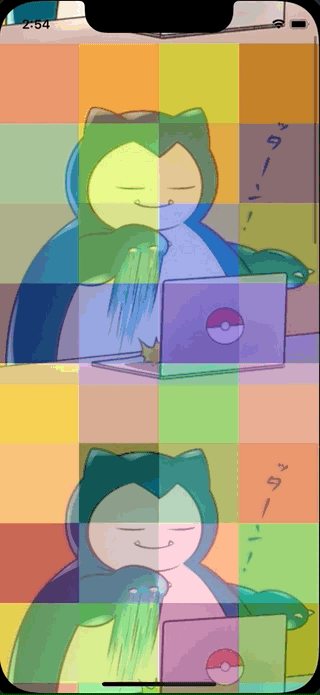

+++
title =  "CollectionViewの背景にスクロールする画像を設定する"
url = "2022-02-03"
date = "2022-02-03"
description = "CollectionViewの背景にスクロールする画像を設定する"
tags = ["iOS", "Swift", "UIKit"]
categories = ["iOS", "Swift"]
archives = "2022/02"
+++

<br>

CollectionViewの背景にスクロールする画像を設定する方法です。
よくわかっていないのですが、backgroundColor に画像を設定すると背景にスクロールする画像を設定できます。



<!-- Amazon Ads -->


<!-- Google Ads -->


<!--more-->

**ViewController.swift**

```swift
import UIKit

class ViewController: UIViewController {
    
    var collectionView : UICollectionView!
    
    override func viewDidLoad() {
        super.viewDidLoad()
        
        let viewWidth = view.frame.width
        let viewHeight = view.frame.height
        let collectionFrame = CGRect(x: 0, y: 0, width: viewWidth, height: viewHeight)
        
        // CollectionViewのレイアウトを生成.
        let layout = UICollectionViewFlowLayout()
        
        // Cell一つ一つの大きさ.
        layout.itemSize = CGSize(width:viewWidth / 4, height:viewWidth / 4)
        
        // セルのマージン.
        layout.sectionInset = UIEdgeInsets.zero

        // セルの横方向のマージン
        layout.minimumInteritemSpacing = 0.0
        
        // セルの縦方向のマージン
        layout.minimumLineSpacing = 0.0
        
        // セクション毎のヘッダーサイズ.
        layout.headerReferenceSize = CGSize(width:0,height:0)
        
        // CollectionViewを生成.
        collectionView = UICollectionView(frame: collectionFrame, collectionViewLayout: layout)
        
        // Cellに使われるクラスを登録.
        collectionView.register(UICollectionViewCell.self, forCellWithReuseIdentifier: NSStringFromClass(UICollectionViewCell.self))
        
        collectionView.delegate = self
        collectionView.dataSource = self
        
        
        let backgroundImage = UIImage(named: "icon")!
        collectionView.backgroundColor = UIColor(patternImage: backgroundImage)
        
        view.addSubview(collectionView)
    }
    
    // ランダムに色を生成する
    func makeColor() -> UIColor {
        let r: CGFloat = CGFloat(arc4random_uniform(255)+1) / 255.0
        let g: CGFloat = CGFloat(arc4random_uniform(255)+1) / 255.0
        let b: CGFloat = CGFloat(arc4random_uniform(255)+1) / 255.0
        let color: UIColor = UIColor(red: r, green: g, blue: b, alpha: 1.0)
        return color
    }
}

extension ViewController: UICollectionViewDataSource {
    // Cellの総数を返す
    func collectionView(_ collectionView: UICollectionView, numberOfItemsInSection section: Int) -> Int {
        return 100
    }
    
    // Cellに値を設定する
    func collectionView(_ collectionView: UICollectionView, cellForItemAt indexPath: IndexPath) -> UICollectionViewCell {
        let cell: UICollectionViewCell = collectionView.dequeueReusableCell(withReuseIdentifier: NSStringFromClass(UICollectionViewCell.self), for: indexPath as IndexPath)
        cell.backgroundColor = makeColor().withAlphaComponent(0.5)
        return cell
    }
}

extension ViewController: UICollectionViewDelegate {
    // Cellが選択された際に呼び出される
    func collectionView(_ collectionView: UICollectionView, didSelectItemAt indexPath: IndexPath) {
        print("Num: \(indexPath.row)")
    }
}
```


