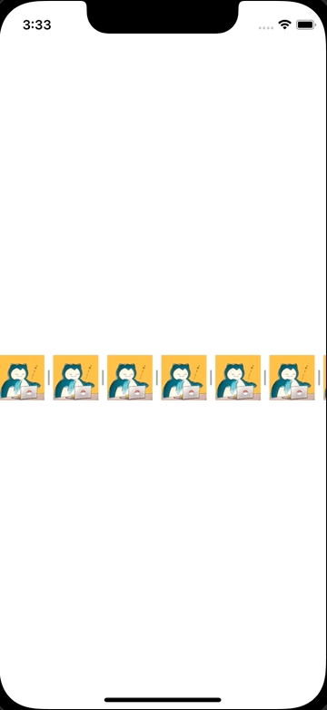

+++
title =  "CollectionViewに区切り線を追加する"
url = "2022-02-04"
date = "2022-02-04"
description = "CollectionViewに区切り線を追加する"
tags = ["iOS", "Swift", "UIKit"]
categories = ["iOS", "Swift"]
archives = "2022/02"
+++

<br>

CollectionViewに区切り線を追加する方法です。



参考:

[UICollectionView の Layout で悩んだら](https://techlife.cookpad.com/entry/2017/06/29/190000)

[Decoration Viewを用いてCollection Viewに区切り線と背景を追加する](https://qiita.com/imk2o/items/fa1f4cc0b4bbe4244226)

<!-- Amazon Ads -->


<!-- Google Ads -->


<!--more-->

**CollectionViewFlowLayoutWithDecorations.swift**

```swift
import UIKit

class CollectionViewFlowLayoutWithDecorations: UICollectionViewFlowLayout {
    enum DecorationViewElementKind: String {
        case verticalSeparator

        static var separators: [DecorationViewElementKind] {
            return [ .verticalSeparator]
        }
    }

    let separatorSize: CGSize = CGSize(width: 2, height: 2)

    override init() {
        super.init()
        
        register(SeparatorView.self, forDecorationViewOfKind: DecorationViewElementKind.verticalSeparator.rawValue)
    }
    
    required init?(coder: NSCoder) {
        fatalError("init(coder:) has not been implemented")
    }

    override func layoutAttributesForElements(in rect: CGRect) -> [UICollectionViewLayoutAttributes]? {
        guard let layoutAttributesArray = super.layoutAttributesForElements(in: rect) else {
            return nil
        }
        
        var decorationLayoutAttributesArray: [UICollectionViewLayoutAttributes] = []
        for layoutAttributes in layoutAttributesArray {
            let indexPath = layoutAttributes.indexPath
            decorationLayoutAttributesArray += DecorationViewElementKind.separators.compactMap {
                return layoutAttributesForDecorationView(ofKind: $0.rawValue, at: indexPath)
            }
        }

        return layoutAttributesArray + decorationLayoutAttributesArray
    }
    
    override func layoutAttributesForDecorationView(ofKind elementKind: String, at indexPath: IndexPath) -> UICollectionViewLayoutAttributes? {
        
        guard let decorationViewElementKind = DecorationViewElementKind(rawValue: elementKind) else {
            return super.layoutAttributesForDecorationView(ofKind: elementKind, at: indexPath)
        }
        
        switch decorationViewElementKind {
        case .verticalSeparator:
            guard
                indexPath.row > 0,
                separatorSize.width > 0,
                let itemLayoutAttributes = layoutAttributesForItem(at: indexPath)
            else {
                return nil
            }
            
            let layoutAttributes = UICollectionViewLayoutAttributes(forDecorationViewOfKind: elementKind, with: indexPath)
            layoutAttributes.frame = CGRect(
                x: itemLayoutAttributes.frame.origin.x - ((minimumInteritemSpacing + separatorSize.width) / 2).rounded(.down),
                y: itemLayoutAttributes.frame.origin.y,
                width: separatorSize.width,
                height: itemLayoutAttributes.frame.size.height
            )
            return layoutAttributes
        }
    }
}
```


**SeparatorView.swift**

```swift
import UIKit

class SeparatorView: UICollectionReusableView {
    
    let path = UIBezierPath()
    let shapeLayer = CAShapeLayer()
    
    override init(frame: CGRect) {
        super.init(frame: frame)
    }
    
    required init?(coder aDecoder: NSCoder) {
        fatalError("init(coder:) has not been implemented")
    }
    
    override func apply(_ layoutAttributes: UICollectionViewLayoutAttributes) {
        self.frame = layoutAttributes.frame
    }
    
    override func layoutSubviews() {
        super.layoutSubviews()
        
        path.move(to: CGPoint(x: frame.size.width / 2, y: 4))
        path.addLine(to: CGPoint(x: frame.size.width / 2, y: frame.size.height - 4))
        
        shapeLayer.path = path.cgPath
        shapeLayer.strokeColor = UIColor.lightGray.cgColor
        shapeLayer.lineWidth = 2
        shapeLayer.lineCap = CAShapeLayerLineCap.round
        layer.addSublayer(shapeLayer)
    }
}
```


**ViewController.swift**

```swift
import UIKit

class ViewController: UIViewController {
    
    var collectionView : UICollectionView!
    
    override func viewDidLoad() {
        super.viewDidLoad()
        
        // CollectionViewのレイアウトを生成.
        let layout = CollectionViewFlowLayoutWithDecorations()
        
        layout.scrollDirection = .horizontal
        
        // Cell一つ一つの大きさ.
        layout.itemSize = CGSize(width: 52, height: 52)
        
        // セルのマージン.
        layout.sectionInset = UIEdgeInsets.zero

        // セルの横方向のマージン
        layout.minimumInteritemSpacing = 10
        
        // セルの縦方向のマージン
        layout.minimumLineSpacing = 10
        
        // セクション毎のヘッダーサイズ.
        layout.headerReferenceSize = CGSize(width: 0, height: 0)
        
        // CollectionViewを生成.
        let collectionFrame = CGRect(x: 0, y: view.bounds.height / 2, width: view.bounds.width, height: 52)
        collectionView = UICollectionView(frame: collectionFrame, collectionViewLayout: layout)
        
        // Cellに使われるクラスを登録.
        collectionView.register(UICollectionViewCell.self, forCellWithReuseIdentifier: NSStringFromClass(UICollectionViewCell.self))
        
        // Indicater を隠す
        collectionView.showsVerticalScrollIndicator = false
        collectionView.showsHorizontalScrollIndicator = false

        collectionView.delegate = self
        collectionView.dataSource = self
        
        collectionView.backgroundColor = UIColor.clear

        view.addSubview(collectionView)
        
        view.backgroundColor = .white
    }
}

extension ViewController: UICollectionViewDataSource {
    // Cellの総数を返す
    func collectionView(_ collectionView: UICollectionView, numberOfItemsInSection section: Int) -> Int {
        return 25
    }
    
    // Cellに値を設定する
    func collectionView(_ collectionView: UICollectionView, cellForItemAt indexPath: IndexPath) -> UICollectionViewCell {
        let cell: UICollectionViewCell = collectionView.dequeueReusableCell(withReuseIdentifier: NSStringFromClass(UICollectionViewCell.self), for: indexPath as IndexPath)
        cell.backgroundView = UIImageView(image: UIImage(named: "icon")!)
        return cell
    }
}

extension ViewController: UICollectionViewDelegate {
    // Cellが選択された際に呼び出される
    func collectionView(_ collectionView: UICollectionView, didSelectItemAt indexPath: IndexPath) {
        print("Num: \(indexPath.row)")
    }
}
```


