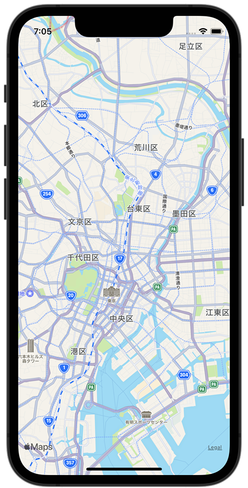

+++
title =  "MKMapViewの表示範囲を設定する"
url = "2022-02-05"
date = "2022-02-05"
description = "MKMapViewの表示範囲を設定する"
tags = ["iOS", "Swift", "UIKit"]
categories = ["iOS", "Swift"]
archives = "2022/02"
+++

<br>

MKMapViewの表示範囲を設定する方法です。
秋葉原駅（35.6984, 139.7731）を中心として緯度経度が±0.1となるように表示されます。



参考: [【Swift】MapKitで経由地点を含めたルートディレクションの表示方法](https://orangelog.site/swift/mapkit-waypoints-route-direction/)


<!-- Amazon Ads -->


<!-- Google Ads -->


<!--more-->

**ViewController.swift**

```swift
import UIKit
import MapKit

class ViewController: UIViewController {

    let mapView: MKMapView = MKMapView()

    override func viewDidLoad() {
        super.viewDidLoad()

        // Akihabara Station
        let coordinate = CLLocationCoordinate2DMake(35.6984, 139.7731)
        let span = MKCoordinateSpan(latitudeDelta: 0.1, longitudeDelta: 0.1)
        let region = MKCoordinateRegion(center: coordinate, span: span)
        mapView.setRegion(region, animated: true)
        mapView.frame = view.bounds
        view.addSubview(mapView)
    }
}
```


