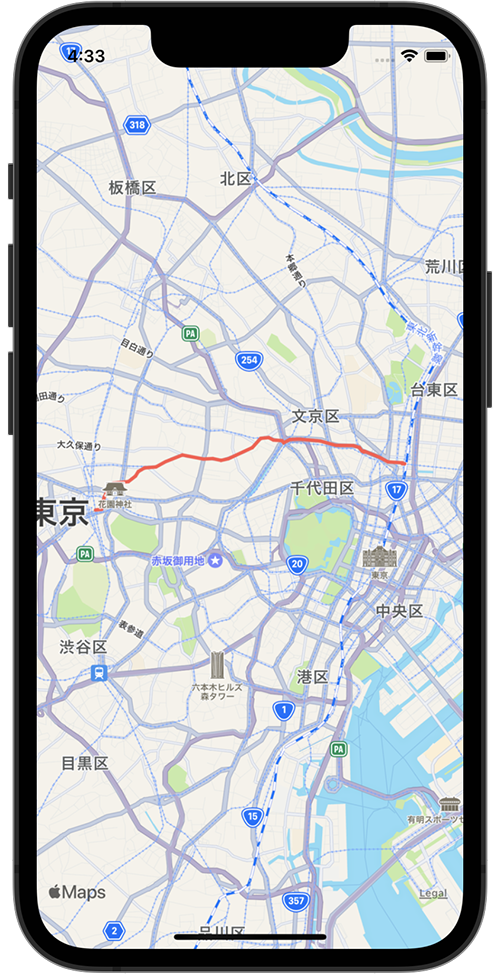

+++
title =  "MKMapViewで経路を表示する"
url = "2022-02-06"
date = "2022-02-06"
description = "MKMapViewで経路を表示する"
tags = ["iOS", "Swift", "UIKit"]
categories = ["iOS", "Swift"]
archives = "2022/02"
+++

<br>

MKMapViewで経路を表示する方法です。
新宿駅から秋葉原駅への経路を表示しています。



参考: [【Swift】MapKitで経由地点を含めたルートディレクションの表示方法](https://orangelog.site/swift/mapkit-waypoints-route-direction/)


<!-- Amazon Ads -->


<!-- Google Ads -->


<!--more-->

**ViewController.swift**

```swift
import UIKit
import MapKit

class ViewController: UIViewController {
    
    private var mapView: MKMapView = MKMapView()
    
    override func viewDidLoad() {
        super.viewDidLoad()
        mapView.delegate = self
        mapView.frame = view.bounds
        view.addSubview(mapView)
        
        // Shinjuku Station
        let sourceLocation = CLLocationCoordinate2D(latitude: 35.6896, longitude: 139.7006)
        
        // Akihabara Station
        let destinationLocation = CLLocationCoordinate2D(latitude: 35.6984, longitude: 139.7731)

        // set rigion
        let coordinate = CLLocationCoordinate2DMake((sourceLocation.latitude + destinationLocation.latitude) / 2, (sourceLocation.longitude + destinationLocation.longitude) / 2)
        let span = MKCoordinateSpan(latitudeDelta: 0.1, longitudeDelta: 0.1)
        let region = MKCoordinateRegion(center: coordinate, span: span)
        mapView.setRegion(region, animated: true)
        
        // calc direction
        let sourcePlacemark = MKPlacemark(coordinate: sourceLocation, addressDictionary: nil)
        let sourceMapItem = MKMapItem(placemark: sourcePlacemark)
        
        let destinationPlacemark = MKPlacemark(coordinate: destinationLocation, addressDictionary: nil)
        let destinationMapItem = MKMapItem(placemark: destinationPlacemark)
        
        let directionsRequest = MKDirections.Request()
        directionsRequest.transportType = .walking
        directionsRequest.source = sourceMapItem
        directionsRequest.destination = destinationMapItem
        let direction = MKDirections(request: directionsRequest)
        direction.calculate { [weak self] response, error in
            guard let response = response, let route = response.routes.first else {
                return
            }
                        
            self?.mapView.addOverlay(route.polyline, level: .aboveRoads)
        }
    }
}

extension ViewController: MKMapViewDelegate {
    func mapView(_ mapView: MKMapView, rendererFor overlay: MKOverlay) -> MKOverlayRenderer {
        let route: MKPolyline = overlay as! MKPolyline
        let routeRenderer = MKPolylineRenderer(polyline: route)
        routeRenderer.strokeColor = UIColor(red:1.00, green:0.35, blue:0.30, alpha:1.0)
        routeRenderer.lineWidth = 3.0
        return routeRenderer
    }
}
```


