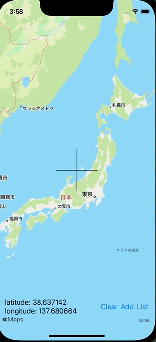

+++
title =  "SwiftUIでMapViewを使い複数の位置情報を選択する"
url = "2022-03-07"
date = "2022-03-07"
description = "SwiftUIでMapViewを使い複数の位置情報を選択する"
tags = ["iOS", "Swift", "SwiftUI"]
categories = ["iOS", "SwiftUI"]
archives = "2022/03"
+++

<br>

SwiftUIでMapViewを使い複数の位置情報を選択する方法です。
addボタンを押した位置情報を記録します。listボタンを押すとその位置情報の一覧を表示します。



<!-- Amazon Ads -->


<!-- Google Ads -->


<!--more-->

**ContentView.swift**

```swift
import SwiftUI
import MapKit

struct ContentView: View {
    @State private var location: CLLocationCoordinate2D?
    @State private var locations: [CLLocationCoordinate2D] = []
    @State private var showingSheet: Bool = false

    var body: some View {
        ZStack(alignment: .bottomLeading) {
            LocationSelecterView(locations: locations) { location in
                self.location = location
            }
            
            HStack {
                VStack(alignment: .leading) {
                    if let location = location {
                        Text("latitude: \(location.latitude)")
                        Text("longitude: \(location.longitude)")
                    }
                }
                
                Spacer()
                                
                Button {
                    locations = []
                } label: {
                    Text("Clear")
                }
                
                Button {
                    if let location = location {
                        locations.append(location)
                    }
                } label: {
                    Text("Add")
                }

                Button {
                    showingSheet = true
                } label: {
                    Text("List")
                }
            }
            .padding(.horizontal, 16)
            .padding(.bottom, 60)
        }
        .sheet(isPresented: $showingSheet) {
            LocationListView(locations: $locations)
        }
        .ignoresSafeArea(.all, edges: .all)
    }
}
```


**LocationListView.swift**

```swift
import SwiftUI
import MapKit

struct LocationListView: View {
    @Binding var locations: [CLLocationCoordinate2D]

    var body: some View {
        List {
            ForEach(0 ..< locations.count, id: \.self) { index in
                VStack(alignment: .leading) {
                    Text("lat: \(locations[index].latitude.description)")
                    Text("lon: \(locations[index].longitude.description)")
                }
            }
        }
    }
}
```


**LocationSelecterView.swift**

```swift
import SwiftUI
import MapKit

public struct LocationSelecterView: UIViewRepresentable {
    let locations: [CLLocationCoordinate2D]
    let locationDidSet: (_ location: CLLocationCoordinate2D) -> Void
    final public class Coordinator: NSObject, LocationSelecterViewDelegate {
        private var mapView: LocationSelecterView
        let locationDidSet: (_ location: CLLocationCoordinate2D) -> Void

        init(_ mapView: LocationSelecterView, locationDidSet: @escaping (_ location: CLLocationCoordinate2D) -> Void) {
            self.mapView = mapView
            self.locationDidSet = locationDidSet
        }

        public func locationDidSet(location: CLLocationCoordinate2D) {
            locationDidSet(location)
        }
    }

    public func makeCoordinator() -> Coordinator {
        Coordinator(self, locationDidSet: locationDidSet)
    }

    public func makeUIView(context: Context) -> UILocationSelecterView {
        let locationsSelectView = UILocationSelecterView()
        locationsSelectView.delegate = context.coordinator
        return locationsSelectView
    }

    public func updateUIView(_ uiView: UILocationSelecterView, context: Context) {
        
        // clear
        uiView.removeAllAnnotations()
        
        // add
        for location in locations {
            uiView.addAnotation(location: location)
        }
    }
}
```


**UILocationSelecterView.swift**

```swift
import SwiftUI
import MapKit

public protocol LocationSelecterViewDelegate: AnyObject {
    func locationDidSet(location: CLLocationCoordinate2D)
}

public class UILocationSelecterView: UIView {
    public var locationLimit: Int?
    private lazy var mapView = MKMapView()
    weak public var delegate: LocationSelecterViewDelegate?

    private let verticalLine = CAShapeLayer()
    private let horizontalLine = CAShapeLayer()


    required init?(coder aDecoder: NSCoder) {
        super.init(coder: aDecoder)
    }

    override init(frame: CGRect) {
        super.init(frame: frame)

        mapView.delegate = self
        addSubview(mapView)

        verticalLine.fillColor = nil
        verticalLine.opacity = 1.0
        verticalLine.strokeColor = UIColor.black.cgColor
        layer.addSublayer(verticalLine)

        horizontalLine.fillColor = nil
        horizontalLine.opacity = 1.0
        horizontalLine.strokeColor = UIColor.black.cgColor
        layer.addSublayer(horizontalLine)
    }

    public override func layoutSubviews() {
        mapView.frame =  CGRect(x: 0, y: 0, width: bounds.width, height: bounds.height)

        let verticalLinePath = UIBezierPath()
        verticalLinePath.move(to: CGPoint(x: (bounds.width / 2) - 50, y: bounds.height / 2))
        verticalLinePath.addLine(to: CGPoint(x: (bounds.width / 2) + 50, y: bounds.height / 2))
        verticalLine.path = verticalLinePath.cgPath

        let horizontalLinePath = UIBezierPath()
        horizontalLinePath.move(to: CGPoint(x: bounds.width / 2, y: (bounds.height / 2) - 50))
        horizontalLinePath.addLine(to: CGPoint(x: bounds.width / 2, y: (bounds.height / 2) + 50))
        horizontalLine.path = horizontalLinePath.cgPath
    }
    
    // Remove All Annotation
    func removeAllAnnotations() {
        mapView.removeAnnotations(mapView.annotations)
    }
    
    // Anotation
    func addAnotation(location: CLLocationCoordinate2D) {
        let annotation = MKPointAnnotation()
        annotation.coordinate = location
        annotation.title = "lat: \(location.latitude), lon: \(location.longitude)"
        mapView.addAnnotation(annotation)
    }
}

extension UILocationSelecterView: MKMapViewDelegate {
    public func mapView(_ mapView: MKMapView, regionDidChangeAnimated animated: Bool) {
        let location = CLLocationCoordinate2D(latitude: mapView.region.center.latitude, longitude: mapView.region.center.longitude)
        delegate?.locationDidSet(location: location)
    }
}
```


