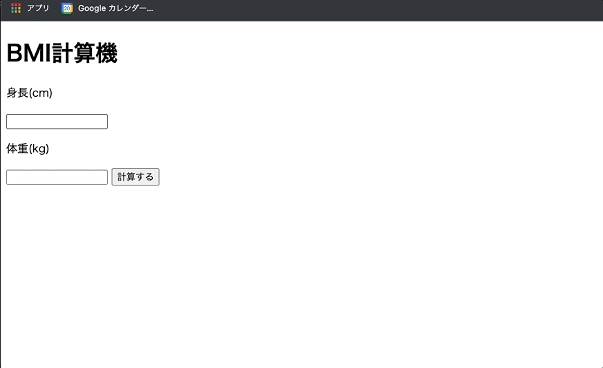

+++
title =  "JavaScriptでBMI計算機を作る"
url = "2022-05-03"
date = "2022-05-03"
description = "JavaScriptでBMI計算機を作る"
tags = ["JavaScript"]
categories = ["JavaScript"]
archives = "2022/05"
+++

<br>

JavaScriptでBMI計算機を作る方法です。



<!-- Amazon Ads -->


<!-- Google Ads -->


<!--more-->

**index.html**

```html
<!DOCTYPE html>
<html lang="ja">
<head>
    <meta charset="UTF-8">
    <title>BMI</title>
    <script type="text/javascript" src="script.js"></script>
</head>
<body>
  <h1>BMI計算機</h1>

  <p>身長(cm)</p>
  <input id="hight" type="text">

  <p>体重(kg)</p>
  <input id="weight" type="text">

  <input type="button" value="計算する" onclick="calc();"/>
</body>
</html>
```


**script.js**

```javascript
function calc() {
    const hight = document.getElementById("hight").value;
    console.log(hight);

    const weight = document.getElementById("weight").value;
    console.log(weight);

    const bmi = weight / ((hight / 100) * (hight / 100));
    console.log(bmi);

    const result = 'BMIは' + bmi + 'です';
    alert(result);
}
```

