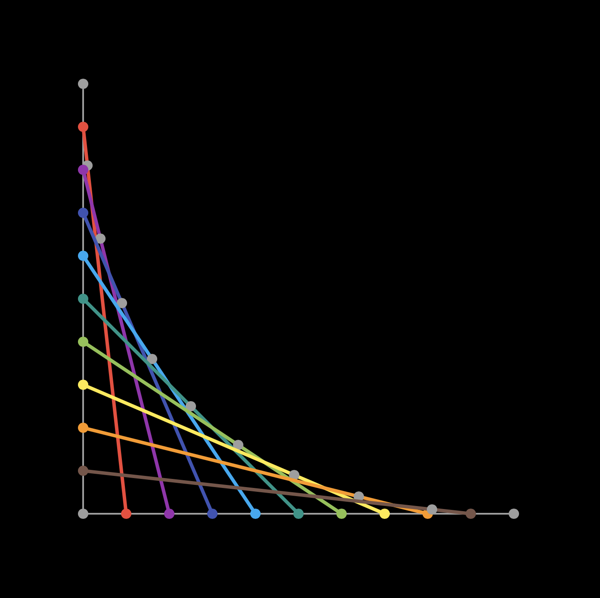

+++
title =  "Playgroundで2次のベジェ曲線を描画する"
url = "2022-06-01"
date = "2022-06-01"
description = "Playgroundで2次のベジェ曲線を描画する"
tags = ["Swift"]
categories = ["Swift"]
archives = "2022/05"
+++

<br>

Playgroundで2次のベジェ曲線を描画する方法です。
[あなたの知らないベジェ曲線の世界](https://qiita.com/takoikatakotako/items/39e3d46dd9f7a700c0b3) に詳細な解説があります。



<!-- Amazon Ads -->


<!-- Google Ads -->


<!--more-->

**Playground.swift**

```swift
import PlaygroundSupport
import XCPlayground
import UIKit

let view = UIView()
view.frame = CGRect(x: 0, y: 0, width: 700, height: 700)
view.backgroundColor = .black

struct Point {
    let x: Double
    let y: Double
    
    var cgPoint: CGPoint {
        CGPoint(x: Double(self.x), y: Double(self.y))
    }
}

func addPoint(point: Point, color: UIColor, lineWidth: CGFloat) {
    let circlePath = UIBezierPath(arcCenter: CGPoint(x: point.x, y: point.y), radius: CGFloat(lineWidth), startAngle: CGFloat(0), endAngle: CGFloat(Double.pi * 2), clockwise: true)
    let shapeLayer = CAShapeLayer()
    shapeLayer.path = circlePath.cgPath
    shapeLayer.fillColor = color.cgColor
    shapeLayer.strokeColor = color.cgColor
    shapeLayer.lineWidth = lineWidth
    view.layer.addSublayer(shapeLayer)
}

func drawLine(from: CGPoint, to: CGPoint, color: UIColor, lineWidth: CGFloat) {
    let path = UIBezierPath()
    path.move(to: from)
    path.addLine(to: to)
    let shapeLayer = CAShapeLayer()
    shapeLayer.path = path.cgPath
    shapeLayer.fillColor = color.cgColor
    shapeLayer.strokeColor = color.cgColor
    shapeLayer.lineWidth = lineWidth
    view.layer.addSublayer(shapeLayer)
}

func drawLine(from: Point, to: Point, color: UIColor, lineWidth: CGFloat) {
    let path = UIBezierPath()
    path.move(to: from.cgPoint)
    path.addLine(to: to.cgPoint)
    let shapeLayer = CAShapeLayer()
    shapeLayer.path = path.cgPath
    shapeLayer.fillColor = color.cgColor
    shapeLayer.strokeColor = color.cgColor
    shapeLayer.lineWidth = lineWidth
    view.layer.addSublayer(shapeLayer)
}

extension UIColor {
    convenience init(hex: String, alpha: CGFloat = 1.0) {
        var hexFormatted: String = hex.trimmingCharacters(in: CharacterSet.whitespacesAndNewlines).uppercased()
        
        if hexFormatted.hasPrefix("#") {
            hexFormatted = String(hexFormatted.dropFirst())
        }
        
        assert(hexFormatted.count == 6, "Invalid hex code used.")
        
        var rgbValue: UInt64 = 0
        Scanner(string: hexFormatted).scanHexInt64(&rgbValue)
        
        self.init(red: CGFloat((rgbValue & 0xFF0000) >> 16) / 255.0,
                  green: CGFloat((rgbValue & 0x00FF00) >> 8) / 255.0,
                  blue: CGFloat(rgbValue & 0x0000FF) / 255.0,
                  alpha: alpha)
    }
}

let red = UIColor(hex: "#f44336", alpha: 1.0)
let purple = UIColor(hex: "#9c27b0", alpha: 1.0)
let blue = UIColor(hex: "#3f51b5", alpha: 1.0)
let lightBlue = UIColor(hex: "#03a9f4", alpha: 1.0)
let green = UIColor(hex: "#009688", alpha: 1.0)
let lightGreen = UIColor(hex: "#8bc34a", alpha: 1.0)
let yellow = UIColor(hex: "#ffeb3b", alpha: 1.0)
let orange = UIColor(hex: "#ff9800", alpha: 1.0)
let brown = UIColor(hex: "#795548", alpha: 1.0)
let gray = UIColor(hex: "#9e9e9e", alpha: 1.0)

let p0 = Point(x: 100, y: 100)
let p1 = Point(x: 100, y: 600)
let p2 = Point(x: 600, y: 600)

addPoint(point: p0, color: gray, lineWidth: 4)
addPoint(point: p1, color: gray, lineWidth: 4)
addPoint(point: p2, color: gray, lineWidth: 4)

drawLine(from: p0, to: p1, color: gray, lineWidth: 2)
drawLine(from: p1, to: p2, color: gray, lineWidth: 2)


// 1:9
let a0 = Point(x: 100, y: 100 + 50)
let b0 = Point(x: 100 + 50, y: 600)
addPoint(point: a0, color: red, lineWidth: 4)
addPoint(point: b0, color: red, lineWidth: 4)
drawLine(from: a0, to: b0, color: red, lineWidth: 4)

let q0 = Point(x: 100 + 5, y: 100 + 50 + 45)
addPoint(point: q0, color: gray, lineWidth: 4)

// 2:8
let a1 = Point(x: 100, y: 100 + 100)
let b1 = Point(x: 100 + 100, y: 600)
addPoint(point: a1, color: purple, lineWidth: 4)
addPoint(point: b1, color: purple, lineWidth: 4)
drawLine(from: a1, to: b1, color: purple, lineWidth: 4)

let q1 = Point(x: 100 + 20, y: 100 + 100 + 80)
addPoint(point: q1, color: gray, lineWidth: 4)

// 3:7
let a2 = Point(x: 100, y: 100 + 150)
let b2 = Point(x: 100 + 150, y: 600)
addPoint(point: a2, color: blue, lineWidth: 4)
addPoint(point: b2, color: blue, lineWidth: 4)
drawLine(from: a2, to: b2, color: blue, lineWidth: 4)

let q2 = Point(x: 100 + 45, y: 100 + 150 + 105)
addPoint(point: q2, color: gray, lineWidth: 4)

// 4:6
let a3 = Point(x: 100, y: 100 + 200)
let b3 = Point(x: 100 + 200, y: 600)
addPoint(point: a3, color: lightBlue, lineWidth: 4)
addPoint(point: b3, color: lightBlue, lineWidth: 4)
drawLine(from: a3, to: b3, color: lightBlue, lineWidth: 4)

let q3 = Point(x: 100 + 80, y: 100 + 200 + 120)
addPoint(point: q3, color: gray, lineWidth: 4)

// 5:5
let a4 = Point(x: 100, y: 100 + 250)
let b4 = Point(x: 100 + 250, y: 600)
addPoint(point: a4, color: green, lineWidth: 4)
addPoint(point: b4, color: green, lineWidth: 4)
drawLine(from: a4, to: b4, color: green, lineWidth: 4)

let q4 = Point(x: 100 + 125, y: 100 + 250 + 125)
addPoint(point: q4, color: gray, lineWidth: 4)

// 6:4
let a5 = Point(x: 100, y: 100 + 300)
let b5 = Point(x: 100 + 300, y: 600)
addPoint(point: a5, color: lightGreen, lineWidth: 4)
addPoint(point: b5, color: lightGreen, lineWidth: 4)
drawLine(from: a5, to: b5, color: lightGreen, lineWidth: 4)

let q5 = Point(x: 100 + 180, y: 100 + 300 + 120)
addPoint(point: q5, color: gray, lineWidth: 4)

// 7:3
let a6 = Point(x: 100, y: 100 + 350)
let b6 = Point(x: 100 + 350, y: 600)
addPoint(point: a6, color: yellow, lineWidth: 4)
addPoint(point: b6, color: yellow, lineWidth: 4)
drawLine(from: a6, to: b6, color: yellow, lineWidth: 4)

let q6 = Point(x: 100 + 245, y: 100 + 350 + 105)
addPoint(point: q6, color: gray, lineWidth: 4)

// 8:2
let a7 = Point(x: 100, y: 100 + 400)
let b7 = Point(x: 100 + 400, y: 600)
addPoint(point: a7, color: orange, lineWidth: 4)
addPoint(point: b7, color: orange, lineWidth: 4)
drawLine(from: a7, to: b7, color: orange, lineWidth: 4)

let q7 = Point(x: 100 + 320, y: 100 + 400 + 80)
addPoint(point: q7, color: gray, lineWidth: 4)

// 9:1
let a8 = Point(x: 100, y: 100 + 450)
let b8 = Point(x: 100 + 450, y: 600)
addPoint(point: a8, color: brown, lineWidth: 4)
addPoint(point: b8, color: brown, lineWidth: 4)
drawLine(from: a8, to: b8, color: brown, lineWidth: 4)

let q8 = Point(x: 100 + 405, y: 100 + 450 + 45)
addPoint(point: q8, color: gray, lineWidth: 4)

PlaygroundPage.current.liveView = view

```


