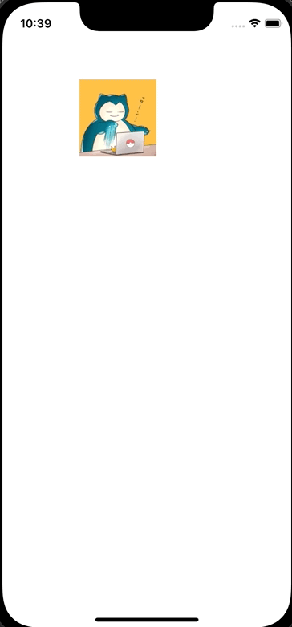

+++
title = "Swiftでタップ、ドラッグした箇所にViewを移動させる"
url = "2022-06-02"
date = "2022-06-02"
description = "Swiftでタップ、ドラッグした箇所にViewを移動させる"
tags = ["Swift"]
categories = ["Swift"]
archives = "2022/05"
+++

<br>

Swiftでタップ、ドラッグした箇所にViewを移動させる方法です。
ViewController でタッチのイベントを検出し、その箇所にViewを移動させています。



<!-- Amazon Ads -->


<!-- Google Ads -->


<!--more-->

**UIViewController.swift**

```swift
import UIKit

class ViewController: UIViewController {
    let imageView = UIImageView()
    
    override func viewDidLoad() {
        super.viewDidLoad()
        
        view.backgroundColor = .white
        
        imageView.image = UIImage(named: "icon")
        imageView.frame = CGRect(x: 100, y: 100, width: 100, height: 100)
        view.addSubview(imageView)
    }
    
    override func touchesBegan(_ touches: Set<UITouch>, with event: UIEvent?) {
        if let touch = touches.first {
            let point = touch.location(in: self.view)
            imageView.center = point
        }
    }
    
    override open func touchesMoved(_ touches: Set<UITouch>, with event: UIEvent?) {
        if let touch = touches.first {
            let point = touch.location(in: self.view)
            imageView.center = point
        }
    }
    
    override open func touchesEnded(_ touches: Set<UITouch>, with event: UIEvent?) {
        if let touch = touches.first {
            let point = touch.location(in: self.view)
            imageView.center = point
        }
    }
}
```


