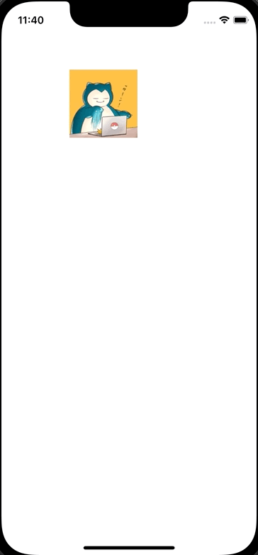

+++
title = "Swiftでドラッグで移動し、長押しでContextMenuを表示する"
url = "2022-06-03"
date = "2022-06-03"
description = "Swiftでドラッグで移動し、長押しでContextMenuを表示する"
tags = ["iOS", "Swift", "UIKit"]
categories = ["Swift"]
archives = "2022/05"
+++

<br>

Swiftでドラッグで移動し、長押しでContextMenuを表示する方法です。
ViewController でタッチのイベントを検出し、その箇所にViewを移動させています。
同時にContextMenuのinteractionも設定しています。



<!-- Amazon Ads -->


<!-- Google Ads -->


<!--more-->

**UIViewController.swift**

```swift
import UIKit

class ViewController: UIViewController {
    let imageView = UIImageView()
    
    override func viewDidLoad() {
        super.viewDidLoad()
        
        view.backgroundColor = .white
        
        imageView.image = UIImage(named: "icon")
        imageView.frame = CGRect(x: 100, y: 100, width: 100, height: 100)
        imageView.isUserInteractionEnabled = true
        view.addSubview(imageView)
        
        let interaction = UIContextMenuInteraction(delegate: self)
        imageView.addInteraction(interaction)
    }
    
    override func touchesBegan(_ touches: Set<UITouch>, with event: UIEvent?) {
        if let touch = touches.first {
            let point = touch.location(in: self.view)
            imageView.center = point
        }
    }
    
    override open func touchesMoved(_ touches: Set<UITouch>, with event: UIEvent?) {
        if let touch = touches.first {
            let point = touch.location(in: self.view)
            imageView.center = point
        }
    }
    
    override open func touchesEnded(_ touches: Set<UITouch>, with event: UIEvent?) {
        if let touch = touches.first {
            let point = touch.location(in: self.view)
            imageView.center = point
        }
    }
}

extension ViewController: UIContextMenuInteractionDelegate {
    func contextMenuInteraction(_ interaction: UIContextMenuInteraction, configurationForMenuAtLocation location: CGPoint) -> UIContextMenuConfiguration? {
        return UIContextMenuConfiguration(identifier: nil, previewProvider: nil, actionProvider: { suggestedActions in
            let fight = UIAction(title: "FIGHT", image: UIImage(systemName: "figure.wave")) { action in
                print("fight")
            }
            let bag = UIAction(title: "BAG", image: UIImage(systemName: "bag")) { action in
                print("bag")
            }
            let pokemon = UIAction(title: "POKEMON", image: UIImage(systemName: "hare")) { action in
                print("pokemon")
            }
            let run = UIAction(title: "RUN", image: UIImage(systemName: "figure.walk")) { action in
                print("run")
            }
            return UIMenu(title: "Menu", children: [fight, bag, pokemon, run])
        })
    }
}
```


