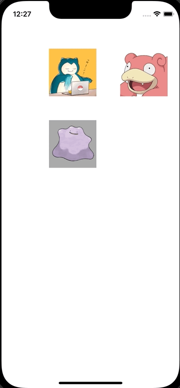

+++
title = "Swiftで複数のViewをドラッグで移動する"
url = "2022-06-04"
date = "2022-06-04"
description = "Swiftで複数のViewをドラッグで移動する"
tags = ["Swift"]
categories = ["Swift"]
archives = "2022/05"
+++

<br>

Swiftで複数のViewをドラッグで移動する方法です。
ViewController でタッチのイベントを検出し、PokemonViewであればViewを移動させています。
同時にContextMenuのinteractionも設定しています。



<!-- Amazon Ads -->


<!-- Google Ads -->


<!--more-->

**UIViewController.swift**

```swift
import UIKit

class PokemonView: UIImageView {}

class ViewController: UIViewController {
    let snorlaxView = PokemonView()
    let slowpokeView = PokemonView()
    let dittoView = PokemonView()
    
    override func viewDidLoad() {
        super.viewDidLoad()
        
        view.backgroundColor = .white
        
        // Snorlax
        snorlaxView.image = UIImage(named: "snorlax")
        snorlaxView.frame = CGRect(x: 100, y: 100, width: 100, height: 100)
        snorlaxView.isUserInteractionEnabled = true
        snorlaxView.backgroundColor = .lightGray
        view.addSubview(snorlaxView)
        
        let snorlaxInteraction = UIContextMenuInteraction(delegate: self)
        snorlaxView.addInteraction(snorlaxInteraction)
        
        // Slowpoke
        slowpokeView.image = UIImage(named: "slowpoke")
        slowpokeView.frame = CGRect(x: 250, y: 100, width: 100, height: 100)
        slowpokeView.isUserInteractionEnabled = true
        slowpokeView.backgroundColor = .lightGray
        view.addSubview(slowpokeView)
        
        let slowpokeInteraction = UIContextMenuInteraction(delegate: self)
        slowpokeView.addInteraction(slowpokeInteraction)
        
        // Ditto
        dittoView.image = UIImage(named: "ditto")
        dittoView.frame = CGRect(x: 100, y: 250, width: 100, height: 100)
        dittoView.isUserInteractionEnabled = true
        dittoView.backgroundColor = .lightGray
        view.addSubview(dittoView)
        
        let dittoInteraction = UIContextMenuInteraction(delegate: self)
        dittoView.addInteraction(dittoInteraction)
    }
    
    override open func touchesMoved(_ touches: Set<UITouch>, with event: UIEvent?) {
        guard let touchevent = touches.first, let pokemonView = touchevent.view as? PokemonView else {
            return
        }
        let previousLocation = touchevent.previousLocation(in: view)
        let nextLocation = touchevent.location(in: view)
        
        let deltaX = nextLocation.x - previousLocation.x
        let deltaY = nextLocation.y - previousLocation.y
        pokemonView.frame.origin.x += deltaX
        pokemonView.frame.origin.y += deltaY
    }
}

extension ViewController: UIContextMenuInteractionDelegate {
    func contextMenuInteraction(_ interaction: UIContextMenuInteraction, configurationForMenuAtLocation location: CGPoint) -> UIContextMenuConfiguration? {
        return UIContextMenuConfiguration(identifier: nil, previewProvider: nil, actionProvider: { suggestedActions in
            let fight = UIAction(title: "FIGHT", image: UIImage(systemName: "figure.wave")) { action in
                print("fight")
            }
            let bag = UIAction(title: "BAG", image: UIImage(systemName: "bag")) { action in
                print("bag")
            }
            let pokemon = UIAction(title: "POKEMON", image: UIImage(systemName: "hare")) { action in
                print("pokemon")
            }
            let run = UIAction(title: "RUN", image: UIImage(systemName: "figure.walk")) { action in
                print("run")
            }
            return UIMenu(title: "Menu", children: [fight, bag, pokemon, run])
        })
    }
}
```


