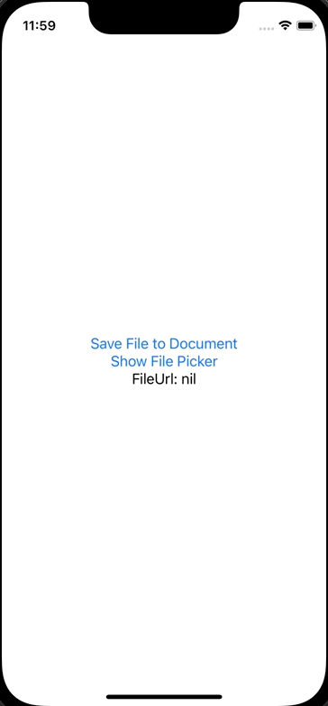
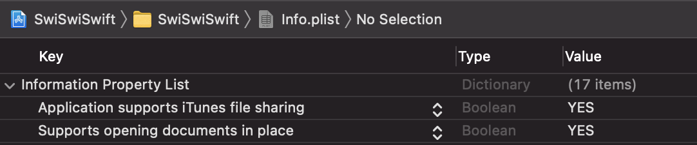

+++
title =  "iOSのファイルアプリ（UIDocumentPickerViewController）を開いてドキュメントフォルダに保存したファイルを開く"
url = "2022-06-05"
date = "2022-06-05"
description = "iOSのファイルアプリ（UIDocumentPickerViewController）を開いてドキュメントフォルダに保存したファイルを開く"
tags = ["Swift", "SwiftUI"]
categories = ["SwiftUI"]
archives = "2021/06"
+++

<br>

iOSのファイルアプリ（UIDocumentPickerViewController）を開いてドキュメントフォルダに保存したファイルを開く方法です。



`info.plist` にファイルアプリでドキュメントディレクトリを開けるように `Supports opening documents in place` と `Application supports iTunes file sharing` を追加し、どちらも `YES` に設定します。



<!-- Amazon Ads -->


<!-- Google Ads -->


<!--more-->

**ContentView.swift**

```swift
import SwiftUI

struct ContentView: View {
    @State private var fileUrl: URL?
    @State private var showingPicker = false
    
    var body: some View {
        VStack {
            Button {
                let documentDirectoryUrl = FileManager.default.urls( for: .documentDirectory, in: .userDomainMask ).first!
                let fileUrl = documentDirectoryUrl.appendingPathComponent("snorlax.txt")
                try! "I Love Snorlax!".data(using: .utf8)!.write(to: fileUrl, options: .atomic)
            } label: {
                Text("Save File to Document")
            }
            
            Button {
                showingPicker = true
            } label: {
                Text("Show File Picker")
            }
            
            Text("FileUrl: \(fileUrl?.description ?? "nil")")
        }
        .sheet(isPresented: $showingPicker) {
            DocumentPickerView(fileUrl: $fileUrl)
        }
    }
}
```


**DocumentPickerView.swift**

```swift
import SwiftUI
import UniformTypeIdentifiers

struct DocumentPickerView : UIViewControllerRepresentable {
    @Binding var fileUrl: URL?
    
    class Coordinator: NSObject, UIDocumentPickerDelegate {
        var parent: DocumentPickerView
        
        init(_ parent: DocumentPickerView) {
            self.parent = parent
        }
        
        func documentPicker(_ controller: UIDocumentPickerViewController, didPickDocumentAt url: URL) {
            self.parent.fileUrl = url
        }
    }
    
    func makeUIViewController(context: Context) -> UIDocumentPickerViewController {
        let documentPickerViewController =  UIDocumentPickerViewController(forOpeningContentTypes: [UTType.text])
        documentPickerViewController.delegate = context.coordinator
        return documentPickerViewController
    }
    
    func updateUIViewController(_ uiViewController: UIDocumentPickerViewController, context: Context) {}
    
    func makeCoordinator() -> Coordinator {
        Coordinator(self)
    }
}
```


