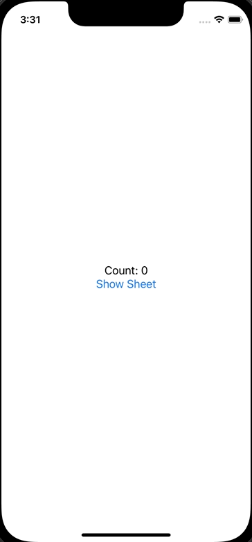

+++
title =  "SwiftUIでObservableObjectの@publishedなプロパティとBindingをする"
url = "2022-06-06"
date = "2022-06-06"
description = "SwiftUIでObservableObjectの@publishedなプロパティとBindingをする"
tags = ["Swift", "SwiftUI"]
categories = ["SwiftUI"]
archives = "2021/06"
+++

<br>

SwiftUIでObservableObjectの@publishedなプロパティとBindingをする方法です。
ここでは AddItemViewState まで ContentView の items をバケツリレーしています。



<!-- Amazon Ads -->


<!-- Google Ads -->


<!--more-->

**AddItemView.swift**

```swift
import SwiftUI

struct AddItemView: View {
    @StateObject var viewState: AddItemViewState
    
    init(items: Binding<[String]>) {
        self._viewState = StateObject(wrappedValue: AddItemViewState(items: items))
    }
    
    var body: some View {
        VStack {
            Text("Count: \(viewState.items.count)")
            
            Button {
                viewState.addItem()
            } label: {
                Text("Add Item")
            }
        }
    }
}
```


**AddItemViewState.swift**

```swift
import SwiftUI

class AddItemViewState: ObservableObject {
    @Binding var bindingItems: [String]
    @Published var items: [String] {
        didSet {
            bindingItems = items
        }
    }
    
    init(items: Binding<[String]>) {
        self.items = items.wrappedValue
        self._bindingItems = items
    }
    
    func addItem() {
        items.append("Mac Book Pro")
    }
}
```


**ContentView.swift**

```swift
import SwiftUI

struct ContentView: View {
    @State var items: [String] = []
    @State var showingSheet: Bool = false
    
    var body: some View {
        VStack {
            Text("Count: \(items.count)")
            
            Button {
                showingSheet = true
            } label: {
                Text("Show Sheet")
            }
        }
        .sheet(isPresented: $showingSheet) {
            AddItemView(items: $items)
        }
    }
}
```

