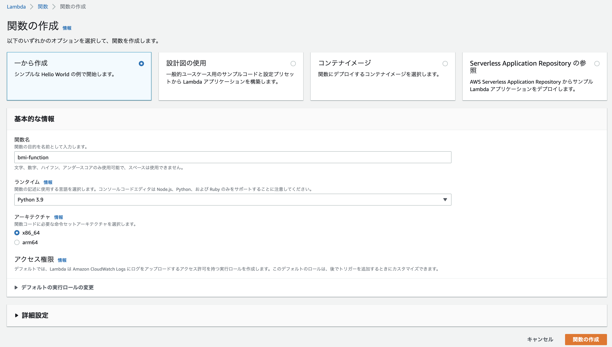
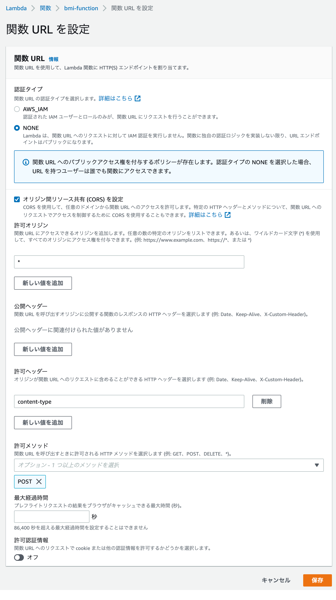

+++
title =  "LambdaでBMIを計算するAPIを作成してJSで呼び出す"
url = "2022-06-08"
date = "2022-06-08"
description = "LambdaでBMIを計算するAPIを作成してJSで呼び出す"
tags = ["AWS", "JavaScript", "Python"]
categories = ["AWS", "JavaScript", "Python"]
archives = "2021/06"
+++

<br>

LambdaでBMIを計算するAPIを作成してJSで呼び出す方法です。


## LambdaでAPIを作成する

Lambdaと関数URLを使ってAPIを作成します。
マネジメントコンソールからLambda関数を作成します。



<!--more-->

**lambda_function.py**

```python
import json

def lambda_handler(event, context):
    body = json.loads(event['body'])
    hight = body['hight']
    weight = body['weight']
    
    bmi = float(weight) / ((float(hight) / 100) ** 2)
    response = {
        'bmi': bmi
    }

    return {
        'statusCode': 200,
        'body': json.dumps(response)
    }
```


以下のcurlコマンドを実行し、bmiが計算されることを確認します。
`{ENDPOINT_URL}` は関数URLの値です。

```
curl -X POST -H "Content-Type: application/json" -d '{"hight":170, "weight":60}' {ENDPOINT_URL}
```

```
{
  "bmi": 20.761245674740486
}
```


## CORSの設定

オリジンが異なるJSからAPIを使うにはCORSの設定を行う必要があります。
許可ヘッダーに `content-type` を入力し、許可メソッドに `POST` を追加します。




## HTMLとJSを作成

以下のコードを参考にしながら `index.html` と `script.js` を作成します。
計算ボタンを押すとBMIが計算されるとBMIがアラートで表示されます。
JS中の `{ENDPOINT_URL}` は関数URLの値を使用します。

**index.html**

```html
<!DOCTYPE html>
<html lang="ja">
<head>
    <meta charset="UTF-8">
    <title>BMI</title>
    <script type="text/javascript" src="script.js"></script>
</head>
<body>
  <h1>BMI計算機</h1>

  <p>身長(cm)</p>
  <input id="hight" type="text">

  <p>体重(kg)</p>
  <input id="weight" type="text">

  <input type="button" value="計算する" onclick="calc();"/>
</body>
</html>
```


**script.js**

```javascript
function calc() {
    const hight = document.getElementById("hight").value;
    const weight = document.getElementById("weight").value;

    const method = "POST";
    const headers = {
      'Content-Type': 'application/json'
    };
    const obj = { 'hight': hight, 'weight': weight };
    const body = JSON.stringify(obj);

    const url = {ENDPOINT_URL}

    fetch(url, {method, headers, body})
    .then(response => {
        return response.json();
    })
    .then(json => {
        alert(json['bmi']);
    });
}
```

