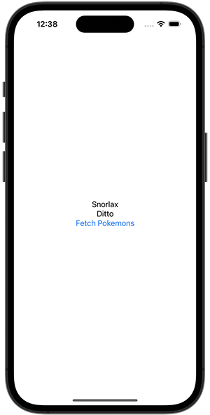

+++
title =  "Swiftのasync,awaitを使ってAPIをフェッチする"
url = "2022-06-15"
date = "2022-06-15"
description = "Swiftのasync,awaitを使ってAPIをフェッチする"
tags = ["Swift", "SwiftUI"]
categories = ["Swift", "SwiftUI"]
archives = "2022/06"
+++

<br>

Swiftのasync,awaitを使ってAPIをフェッチする方法です。
従来のClosureを使った方法とasyncを使った方法です。



<!--more-->

**AsyncAwaitContentView.swift**

```swift
import SwiftUI

struct Pokemon: Codable {
    let name: String
}

struct ContentView: View {
    @State var pokemons: [Pokemon] = []
    
    var body: some View {
        VStack {
            ForEach(pokemons, id: \.self.name) { pokemon in
                Text(pokemon.name)
            }
            
            Button {
                fetchPokemons()
            } label: {
                Text("Fetch Pokemons")
            }
        }
    }
    
    private func fetchPokemons() {
        let url: URL = URL(string: "https://swiswiswift.com/2022-06-15/pokemons.json")!
        let task: URLSessionTask = URLSession.shared.dataTask(with: url, completionHandler: {(data, response, error) in
            if let error = error {
                print(error)
                return
            }
            
            guard let data = data else {
                return
            }
            
            do {
                let pokemons = try JSONDecoder().decode([Pokemon].self, from: data)
                DispatchQueue.main.async {
                    self.pokemons = pokemons
                }
            } catch {
                print(error)
            }
        })
        task.resume()
    }
}
```


**ClosureContentView.swift**

```swift
import SwiftUI

struct Pokemon: Codable {
    let name: String
}

struct ContentView: View {
    @State var pokemons: [Pokemon] = []
    
    var body: some View {
        VStack {
            ForEach(pokemons, id: \.self.name) { pokemon in
                Text(pokemon.name)
            }
            
            Button {
                fetchPokemons()
            } label: {
                Text("Fetch Pokemons")
            }
        }
    }
    
    private func fetchPokemons() {
        let url: URL = URL(string: "https://swiswiswift.com/2022-06-15/pokemons.json")!
        let task: URLSessionTask = URLSession.shared.dataTask(with: url, completionHandler: {(data, response, error) in
            if let error = error {
                print(error)
                return
            }
            
            guard let data = data else {
                return
            }
            
            do {
                let pokemons = try JSONDecoder().decode([Pokemon].self, from: data)
                DispatchQueue.main.async {
                    self.pokemons = pokemons
                }
            } catch {
                print(error)
            }
        })
        task.resume()
    }
}
```

