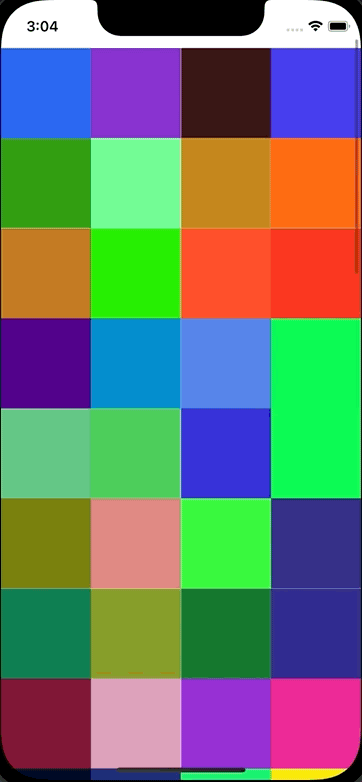

+++
title = "UICollectionViewでContextMenuを使う"
url = "2022-07-14"
date = "2022-07-14"
description = "UICollectionViewでContextMenuを使う"
tags = ["iOS", "Swift", "UIKit"]
categories = ["iOS"]
archives = "2021/07"
+++

<br>

UICollectionViewでContextMenuを使う方法です。
セルを長押しするとContextMenuを表示します。



参考: [iOS13から追加されるContext Menusについて](https://qiita.com/hirothings/items/c4e52dc2d33981c85351)

<!-- Amazon Ads -->


<!-- Google Ads -->


<!--more-->

**ViewController.swift**

```swift
import UIKit

class ViewController: UIViewController {
    
    var myCollectionView : UICollectionView!
    var colors: [UIColor] = []
    
    override func viewDidLoad() {
        super.viewDidLoad()
        
        let layout = UICollectionViewFlowLayout()
        layout.itemSize = CGSize(width: view.bounds.size.width / 4, height: view.bounds.size.width / 4)
        layout.sectionInset = UIEdgeInsets.zero
        layout.minimumInteritemSpacing = 0.0
        layout.minimumLineSpacing = 0.0
        layout.headerReferenceSize = CGSize(width:0,height:0)
        
        let collectionFrame = view.bounds
        myCollectionView = UICollectionView(frame: collectionFrame, collectionViewLayout: layout)
        myCollectionView.register(UICollectionViewCell.self, forCellWithReuseIdentifier: NSStringFromClass(UICollectionViewCell.self))
        myCollectionView.delegate = self
        myCollectionView.dataSource = self
        view.addSubview(myCollectionView)
        
        for _ in 0..<100 {
            colors.append(makeColor())
        }
    }
    
    func makeColor() -> UIColor {
        let r: CGFloat = CGFloat(arc4random_uniform(255)+1) / 255.0
        let g: CGFloat = CGFloat(arc4random_uniform(255)+1) / 255.0
        let b: CGFloat = CGFloat(arc4random_uniform(255)+1) / 255.0
        let color: UIColor = UIColor(red: r, green: g, blue: b, alpha: 1.0)
        return color
    }
}

extension ViewController: UICollectionViewDataSource {
    func collectionView(_ collectionView: UICollectionView, numberOfItemsInSection section: Int) -> Int {
        return colors.count
    }
    
    func collectionView(_ collectionView: UICollectionView, cellForItemAt indexPath: IndexPath) -> UICollectionViewCell {
        let cell : UICollectionViewCell = collectionView.dequeueReusableCell(withReuseIdentifier: NSStringFromClass(UICollectionViewCell.self), for: indexPath as IndexPath)
        cell.backgroundColor = colors[indexPath.row]
        return cell
    }
}

extension ViewController: UICollectionViewDelegate {
    func collectionView(_ collectionView: UICollectionView, didSelectItemAt indexPath: IndexPath) {
        print("Num: \(indexPath.row)")
    }
    
    func collectionView(_ collectionView: UICollectionView, contextMenuConfigurationForItemAt indexPath: IndexPath, point: CGPoint) -> UIContextMenuConfiguration? {
        return UIContextMenuConfiguration(identifier: nil, previewProvider: nil, actionProvider: { suggestedActions in
            let fight = UIAction(title: "FIGHT", image: UIImage(systemName: "figure.wave")) { action in
                print("fight")
            }
            let bag = UIAction(title: "BAG", image: UIImage(systemName: "bag")) { action in
                print("bag")
            }
            let pokemon = UIAction(title: "POKEMON", image: UIImage(systemName: "hare")) { action in
                print("pokemon")
            }
            let run = UIAction(title: "RUN", image: UIImage(systemName: "figure.walk")) { action in
                print("run")
            }
            return UIMenu(title: "Menu", children: [fight, bag, pokemon, run])
        })
    }
}
```

