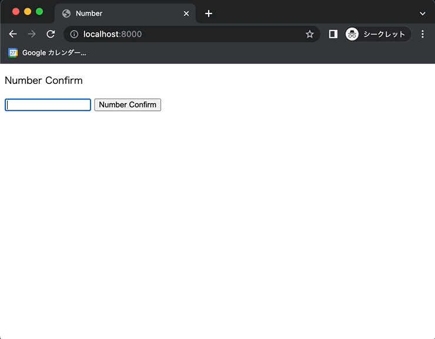

+++
title = "JavaScriptで数値か文字列か判定する"
url = "2022-07-15"
date = "2022-07-15"
description = "JavaScriptで数値か文字列か判定する"
tags = ["JavaScript"]
categories = ["JavaScript"]
archives = "2021/07"
+++

<br>

JavaScriptで数値か文字列か判定する方法です。
`isNaN()` を使うと数値化文字列か判定することができます。
数値ではない場合は `true` 、数値の場合は `false` を返します。



<!-- Amazon Ads -->


<!-- Google Ads -->


<!--more-->

**index.html**

```html
<!DOCTYPE html>
<html lang="ja">
<head>
    <meta charset="UTF-8">
    <title>Number</title>
    <script type="text/javascript" src="script.js"></script>
</head>
<body>
  <p>Number Confirm</p>
  <input id="number" type="text">
  <input type="button" value="Number Confirm" onclick="confirm();"/>
</body>
</html>
```


**script.js**

```javascript
function confirm() {
    const number = document.getElementById("number").value;
    if (isNaN(number)) {
        alert(`「${number}」is not Number`);
    } else {
        alert(`「${number}」is Number`);
    }
}
```

