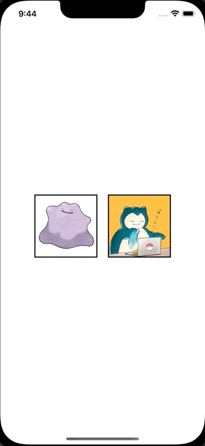

+++
title = "SwiftUIでアラートのメッセージを出し分ける"
url = "2023-01-16"
date = "2023-01-16"
description = "SwiftUIでアラートのメッセージを出し分ける"
tags = ["Swift", "SwiftUI"]
categories = ["SwiftUI"]
archives = "2023/01"
+++

<br>

SwiftUIでアラートのメッセージを出し分ける方法です。
アラート表示前にアラートメッセージを変更しています。



<!-- Google Ads -->


<!-- Amazon Ads -->


<!--more-->

**ContentView.swift**

```swift
import SwiftUI

struct ContentView: View {
    @State var alertMessage: String = ""
    @State var showingAlert: Bool = false
    
    var body: some View {
        HStack(spacing: 20) {
            Button {
                alertMessage = "This is Ditto!!!"
                showingAlert = true
            } label: {
                Image("ditto")
                    .resizable()
                    .frame(width: 120, height: 120)
                    .border(Color.black, width: 2)
            }
            
            Button {
                alertMessage = "This is Snorlax!!!"
                showingAlert = true
            } label: {
                Image("snorlax")
                    .resizable()
                    .frame(width: 120, height: 120)
                    .border(Color.black, width: 2)
            }
        }
        .alert(isPresented: $showingAlert) {
            Alert(title: Text(alertMessage), dismissButton: .default(Text("Close")))
        }
    }
}

struct ContentView_Previews: PreviewProvider {
    static var previews: some View {
        ContentView()
    }
}
```

