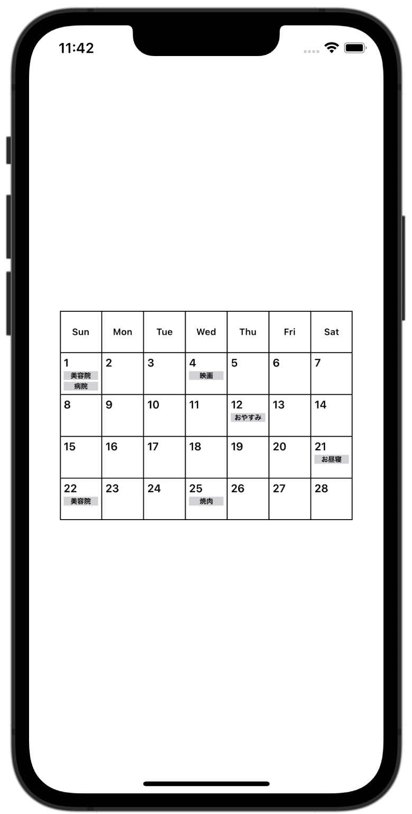

+++
title = "SwiftUIでカレンダーを作成する"
url = "2023-02-08"
date = "2023-02-08"
description = "SwiftUIでカレンダーを作成する"
tags = ["Swift", "SwiftUI"]
categories = ["SwiftUI"]
archives = "2023/01"
+++

<br>

SwiftUIでカレンダーを作成する方法です。
VStack と HStack を組み合わせて作成しました。

2023年2月24日追記
iOS16からUICalendarViewという便利なものが用意されたのでそれを使った方が良いかもしれません。
[こちら](/2023-02-21) の記事です。



<!-- Google Ads -->


<!-- Amazon Ads -->


<!--more-->

**CalenderCell.swift**

```swift
import SwiftUI

struct CalenderCell<Content: View>: View {
    let content: Content

    init(@ViewBuilder content: () -> Content) {
        self.content = content()
    }

    var body: some View {
        VStack(alignment: .leading, spacing: 2) {
            content
        }
        .frame(width: 46, height: 46, alignment: .top)
        .border(Color.black, width: 0.5)
    }
}

struct CalenderCell_Previews: PreviewProvider {
    static var previews: some View {
        CalenderCell {
            NumberText(number: 12)
            ScheduleText(text: "歯医者")
        }
        .previewLayout(.sizeThatFits)
    }
}
```


**ContentView.swift**

```swift
import SwiftUI

struct ContentView: View {
    var body: some View {
        VStack(spacing: 0) {
            HStack(spacing: 0) {
                DayOfWeekText(text: "Sun")
                DayOfWeekText(text: "Mon")
                DayOfWeekText(text: "Tue")
                DayOfWeekText(text: "Wed")
                DayOfWeekText(text: "Thu")
                DayOfWeekText(text: "Fri")
                DayOfWeekText(text: "Sat")
            }
            
            HStack(alignment: .top, spacing: 0) {
                CalenderCell {
                    NumberText(number: 1)
                    ScheduleText(text: "美容院")
                    ScheduleText(text: "病院")
                }
                CalenderCell {
                    NumberText(number: 2)
                }
                CalenderCell {
                    NumberText(number: 3)
                }
                CalenderCell {
                    NumberText(number: 4)
                    ScheduleText(text: "映画")
                }
                CalenderCell {
                    NumberText(number: 5)
                }
                CalenderCell {
                    NumberText(number: 6)
                }
                CalenderCell {
                    NumberText(number: 7)
                }
            }
            
            HStack(alignment: .top, spacing: 0) {
                CalenderCell {
                    NumberText(number: 8)
                }
                CalenderCell {
                    NumberText(number: 9)
                }
                CalenderCell {
                    NumberText(number: 10)
                }
                CalenderCell {
                    NumberText(number: 11)
                }
                CalenderCell {
                    NumberText(number: 12)
                    ScheduleText(text: "おやすみ")
                }
                CalenderCell {
                    NumberText(number: 13)
                }
                CalenderCell {
                    NumberText(number: 14)
                }
            }
            
            HStack(alignment: .top, spacing: 0) {
                CalenderCell {
                    NumberText(number: 15)
                }
                CalenderCell {
                    NumberText(number: 16)
                }
                CalenderCell {
                    NumberText(number: 17)
                }
                CalenderCell {
                    NumberText(number: 18)
                }
                CalenderCell {
                    NumberText(number: 19)
                }
                CalenderCell {
                    NumberText(number: 20)
                }
                CalenderCell {
                    NumberText(number: 21)
                    ScheduleText(text: "お昼寝")
                }
            }
            
            HStack(alignment: .top, spacing: 0) {
                CalenderCell {
                    NumberText(number: 22)
                    ScheduleText(text: "美容院")
                }
                CalenderCell {
                    NumberText(number: 23)
                }
                CalenderCell {
                    NumberText(number: 24)
                }
                CalenderCell {
                    NumberText(number: 25)
                    ScheduleText(text: "焼肉")
                }
                CalenderCell {
                    NumberText(number: 26)
                }
                CalenderCell {
                    NumberText(number: 27)
                }
                CalenderCell {
                    NumberText(number: 28)
                }
            }
        }
        .border(Color.black, width: 1)
    }
}

struct ContentView_Previews: PreviewProvider {
    static var previews: some View {
        ContentView()
    }
}
```


**DayOfWeekText.swift**

```swift
import SwiftUI

struct DayOfWeekText: View {
    let text: String
    var body: some View {
        Text(text)
            .font(.system(size: 10).bold())
            .frame(width: 46, height: 46)
            .border(Color.black, width: 0.5)
    }
}

struct DayOfWeekText_Previews: PreviewProvider {
    static var previews: some View {
        DayOfWeekText(text: "Sun")
    }
}
```


**NumberText.swift**

```swift
import SwiftUI

struct NumberText: View {
    let number: Int
    var body: some View {
        Text(String(number))
            .font(.system(size: 12).bold())
            .padding(.top, 4)
            .padding(.leading, 4)
            .frame(width: 46, alignment: .leading)
    }
}

struct NumberText_Previews: PreviewProvider {
    static var previews: some View {
        NumberText(number: 1)
    }
}
```


**ScheduleText.swift**

```swift
import SwiftUI

struct ScheduleText: View {
    let text: String
    var body: some View {
        HStack(spacing: 0) {
            Text(text)
                .lineLimit(1)
                .font(.system(size: 8).bold())
                .padding(.horizontal, 4)
                .frame(width: 38)
                .background(Color(uiColor: .systemGray4))
        }
        .frame(width: 46, alignment: .center)
    }
}

struct ScheduleText_Previews: PreviewProvider {
    static var previews: some View {
        ScheduleText(text: "美容院")
    }
}
```

