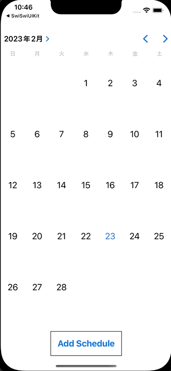

+++
title = "SwiftUIでTODOアプリを作成する"
url = "2023-02-20"
date = "2023-02-20"
description = "SwiftUIでTODOアプリを作成する"
tags = ["Swift", "SwiftUI"]
categories = ["SwiftUI"]
archives = "2023/02"
+++

<br>

SwiftUIでTODOアプリのサンプルを作成してみました。
Add Scheduleボタンを押すと予定入力画面が表示されます。
日付を押すと予定一覧画面が表示され、予定の一覧を確認することができます。



<!-- Google Ads -->


<!-- Amazon Ads -->


<!--more-->

**CalendarView.swift**

```swift
import SwiftUI

struct CalendarView: UIViewRepresentable {
    let didSelectDate: (_ dateComponents: DateComponents) -> Void
    
    final public class Coordinator: NSObject, UICalendarSelectionSingleDateDelegate {
        let didSelectDate: (_ dateComponents: DateComponents) -> Void
        
        init(
            didSelectDate: @escaping (_ dateComponents: DateComponents) -> Void
        ) {
            self.didSelectDate = didSelectDate
        }
        
        public func dateSelection(_ selection: UICalendarSelectionSingleDate, didSelectDate dateComponents: DateComponents?) {
            guard let dateComponents = dateComponents else {
                return
            }
            didSelectDate(dateComponents)
        }
    }
    
    
    public func makeCoordinator() -> Coordinator {
        Coordinator(didSelectDate: didSelectDate)
    }
    
    
    func makeUIView(context: Context) -> some UIView {
        let selection = UICalendarSelectionSingleDate(delegate: context.coordinator)
        
        let calendarView = UICalendarView()
        calendarView.selectionBehavior = selection
        return calendarView
    }
    
    func updateUIView(_ uiView: UIViewType, context: Context) {}
}

struct CalendarView_Previews: PreviewProvider {
    static var previews: some View {
        CalendarView { dateComponents in }
    }
}
```


**ContentView.swift**

```swift
import SwiftUI

struct ContentView: View {
    @State var showingSheet: ContentViewSheetItem?

    var body: some View {
        VStack {
            CalendarView { dateComponents in
                guard let year = dateComponents.year,
                      let month = dateComponents.month,
                      let day = dateComponents.day else {
                    return
                }
                showingSheet = .showScheduleList(year: year, month: month, day: day)
            }
            .padding()
            .navigationTitle("UICalendarView")

            Button {
                showingSheet = .showInputSchedule
            } label: {
                Text("Add Schedule")
                    .font(Font.system(size: 20))
                    .fontWeight(.bold)
                    .padding(16)
                    .border(Color.black, width: 1)
            }
        }
        .sheet(item: $showingSheet, content: { item in
            switch item {
            case .showScheduleList(let year, let month, let day):
                ScheduleList(year: year, month: month, day: day)
            case .showInputSchedule:
                InputScheduleView()
            }
        })
    }
}
```


**ContentViewSheetItem.swift**

```swift
import Foundation

enum ContentViewSheetItem: Hashable, Identifiable {
    var id: Self {
        return self
    }
    case showInputSchedule
    case showScheduleList(year: Int, month: Int, day: Int)
}
```


**InputScheduleView.swift**

```swift
import SwiftUI

struct InputScheduleView: View {
    @Environment(\.dismiss) private var dismiss

    @State var schedule = ""
    @State var date = Date()
    
    var body: some View {
        VStack {
            TextField("Schedule", text: $schedule)
                .textFieldStyle(RoundedBorderTextFieldStyle())
            
            DatePicker(selection: $date, label: { Text("") })
                .environment(\.locale, Locale(identifier: "ja_JP"))
            
            Button {
                let calendar = Calendar.current
                let components = calendar.dateComponents([.year, .month, .day], from: date)
                guard let year = components.year, let month = components.month, let day = components.day else {
                    return
                }
                
                // Add Schedules
                var schedules = UserDefaultsManager.getSchedules(year: year, month: month, day: day)
                schedules.append(schedule)
                
                UserDefaultsManager.setSchedules(year: year, month: month, day: day, schedules: schedules)
                
                dismiss()
            } label: {
                Text("Add")
                    .font(Font.system(size: 20))
                    .fontWeight(.bold)
                    .padding(16)
                    .border(Color.black, width: 1)
            }
        }
        .padding()
    }
}

struct InputScheduleView_Previews: PreviewProvider {
    static var previews: some View {
        InputScheduleView()
    }
}
```


**ScheduleList.swift**

```swift
import SwiftUI

struct ScheduleList: View {
    @State var year: Int
    @State var month: Int
    @State var day: Int
    @State var schedules: [String] = []

    var body: some View {
        List(schedules, id: \.self) { schedule in
            Text(schedule)
        }
        .onAppear {
            schedules = UserDefaultsManager.getSchedules(year: year, month: month, day: day)
        }
    }
}

struct ScheduleListView_Previews: PreviewProvider {
    static var previews: some View {
        ScheduleList(year: 2023, month: 1, day: 1)
    }
}
```


**UserDefaultsManager.swift**

```swift
import Foundation

struct UserDefaultsManager {
    static func getSchedules(year: Int, month: Int, day: Int) -> [String] {
        if let schedules = UserDefaults.standard.object(forKey: "\(year)-\(month)-\(day)") as? [String] {
            return schedules
        }
        return []
    }
    static func setSchedules(year: Int, month: Int, day: Int, schedules: [String]) {
        UserDefaults.standard.set(schedules, forKey: "\(year)-\(month)-\(day)")
    }
}
```


