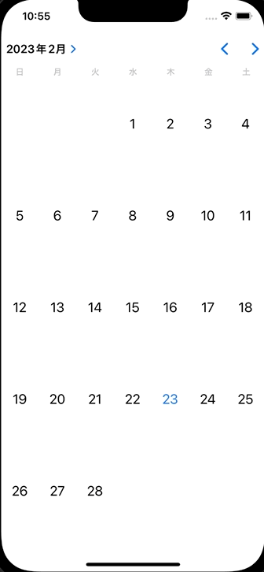

+++
title = "SwiftUIでUICalendarViewを使ってカレンダーを表示する"
url = "2023-02-21"
date = "2023-02-21"
description = "SwiftUIでUICalendarViewを使ってカレンダーを表示する"
tags = ["Swift", "SwiftUI"]
categories = ["Swift"]
archives = "2023/02"
+++

<br>

SwiftUIでUICalendarViewを使ってカレンダーを表示する。
iOS16からUICalendarViewというすごく便利なものが使えるようになりました。
今回はSwiftUIでUICalendarViewを使用し、数字をタップすると日付がコンソールに出力されます。



参考: [How to use UICalendarView in iOS](https://nemecek.be/blog/161/how-to-use-uicalendarview-in-ios)


<!-- Google Ads -->


<!-- Amazon Ads -->


<!--more-->

**CalendarView.swift**

```swift
import SwiftUI

struct CalendarView: UIViewRepresentable {
    let didSelectDate: (_ dateComponents: DateComponents) -> Void
    
    final public class Coordinator: NSObject, UICalendarSelectionSingleDateDelegate {
        let didSelectDate: (_ dateComponents: DateComponents) -> Void
        
        init(
            didSelectDate: @escaping (_ dateComponents: DateComponents) -> Void
        ) {
            self.didSelectDate = didSelectDate
        }
        
        public func dateSelection(_ selection: UICalendarSelectionSingleDate, didSelectDate dateComponents: DateComponents?) {
            guard let dateComponents = dateComponents else {
                return
            }
            didSelectDate(dateComponents)
        }
    }
    
    
    public func makeCoordinator() -> Coordinator {
        Coordinator(didSelectDate: didSelectDate)
    }
    
    
    func makeUIView(context: Context) -> some UIView {
        let selection = UICalendarSelectionSingleDate(delegate: context.coordinator)
        
        let calendarView = UICalendarView()
        calendarView.selectionBehavior = selection
        return calendarView
    }
    
    func updateUIView(_ uiView: UIViewType, context: Context) {}
}

struct CalendarView_Previews: PreviewProvider {
    static var previews: some View {
        CalendarView { dateComponents in
            
        }
    }
}
```


**ContentView.swift**

```swift
import SwiftUI

struct ContentView: View {
    var body: some View {
        CalendarView { dateComponents in
            guard let year = dateComponents.year,
                  let month = dateComponents.month,
                  let day = dateComponents.day else {
                return
            }
            print("yate: \(year), month: \(month), day: \(day)")
        }
    }
}
```


