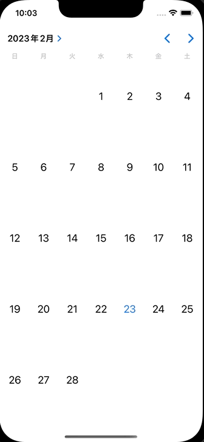

+++
title = "SwiftでUICalendarViewを使ってカレンダーを表示する"
url = "2023-02-22"
date = "2023-02-22"
description = "SwiftでUICalendarViewを使ってカレンダーを表示する"
tags = ["Swift"]
categories = ["Swift"]
archives = "2023/02"
+++

<br>

SwiftでUICalendarViewを使ってカレンダーを表示する方法です。
iOS16からUICalendarViewというすごく便利なものが使えるようになりました。



参考: [How to use UICalendarView in iOS](https://nemecek.be/blog/161/how-to-use-uicalendarview-in-ios)


<!-- Google Ads -->


<!-- Amazon Ads -->


<!--more-->

**ViewController.swift**

```swift
import UIKit

class ViewController: UIViewController {

    override func viewDidLoad() {
        super.viewDidLoad()
        
        view.backgroundColor = .white

        let selection = UICalendarSelectionSingleDate(delegate: self)

        let calendarView = UICalendarView()
        calendarView.frame = view.bounds
        calendarView.delegate = self
        calendarView.selectionBehavior = selection
        view.addSubview(calendarView)
    }
}

extension ViewController: UICalendarViewDelegate {}

extension ViewController: UICalendarSelectionSingleDateDelegate {
    func dateSelection(_ selection: UICalendarSelectionSingleDate, didSelectDate dateComponents: DateComponents?) {
        guard let dateComponents = dateComponents,
        let year = dateComponents.year,
        let month = dateComponents.month,
        let day = dateComponents.day else {
            return
        }
        print("yate: \(year), month: \(month), day: \(day)")
    }
}
```


