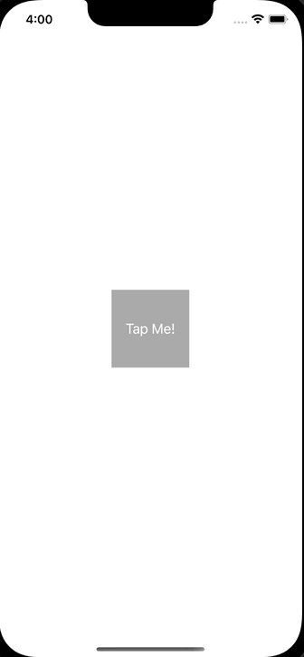

+++
title = "Swiftでモーダル表示時にviewWillDisappearが呼ばれない"
url = "2023-02-23"
date = "2023-02-23"
description = "Swiftでモーダル表示時にviewWillDisappearが呼ばれない"
tags = ["iOS", "Swift", "UIKit"]
categories = ["iOS", "Swift", "UIKit"]
archives = "2023/02"
+++

<br>

Swiftでモーダル表示時にviewWillDisappearが呼ばれないということが起きました。
以下のようにボタンを押したタイミングでフルスクリーンのモーダルが表示されるとします。



`modalPresentationStyle` を `.fullScreen` にすると `viewWillDisappear` と `viewDidAppear` がモーダル表示のタイミングで呼ばれますが、`.overFullScreen` にすると `viewDidAppear` しか呼ばれませんでした。

参考: [iOSにおけるモーダル表示まとめ](https://blog.asial.co.jp/1669)

<!-- Google Ads -->


<!-- Amazon Ads -->


<!--more-->

**SecondViewController.swift**

```swift
import UIKit

class SecondViewController: UIViewController {

    override func viewDidLoad() {
        super.viewDidLoad()
        
        view.backgroundColor = .white
    }
}
```


**ViewController.swift**

```swift
import UIKit

class ViewController: UIViewController {

    override func viewDidLoad() {
        super.viewDidLoad()
        
        view.backgroundColor = .white
        
        let button = UIButton()
        button.setTitle("Tap Me!", for: .normal)
        button.frame.size = CGSize(width: 100, height: 100)
        button.center = view.center
        button.backgroundColor = .lightGray
        button.addTarget(self, action: #selector(tapped), for: .touchUpInside)
        view.addSubview(button)
    }
    
    override func viewWillDisappear(_ animated: Bool) {
        super.viewWillDisappear(animated)
        print("viewWillDisappear")
    }

    override func viewDidAppear(_ animated: Bool) {
        super.viewDidAppear(animated)
        print("viewDidAppear")
    }
    
    @objc func tapped() {
        let secondViewController = SecondViewController()
        
        // viewWillDisappear & viewDidAppear called
        secondViewController.modalPresentationStyle = .fullScreen
        
        // viewDidAppear only called
        secondViewController.modalPresentationStyle = .overFullScreen

        present(secondViewController, animated: true)
    }
}
```


