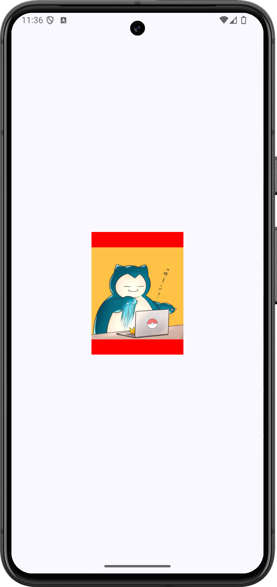

+++
title = "Jetpack Composeで画像全体が収まるように表示する（ContentScale.Fit）"
url = "2023-10-01-jetpack-compose-image-fit"
date = "2023-10-01"
description = "画像の縦横比を保ちながら、指定した領域に全体が収まるように表示します。"
summary = "画像の縦横比を保ちながら、指定した領域に全体が収まるように表示します。"
tags = ["Android", "Jetpack Compose"]
categories = ["Jetpack Compose"]
archives = "2023/10"
+++

画像の縦横比を保ちながら、指定した領域に全体が収まるように表示します。

<!--more-->

<a href="screenshot.png"></a>

## 実装のポイント

`Modifier.size(150.dp, 200.dp)`で表示領域を決めます。`ContentScale.Fit`では画像全体が見え、縦横比の違いで生じた余白に赤い背景が見えます。

## 準備

Android StudioのCompose対応プロジェクトで、Material 3を使用します。以下のコードではパッケージ名を`com.swiswiswift.swiswikotlin`にしています。自分のプロジェクトに合わせて変更してください。テーマは`MaterialTheme`に揃えています。

各記事は独立したサンプルです。同じプロジェクトで試す場合は、前のサンプルの`MainActivity`や`ContentView`を置き換えてください。

[サンプルの画像](snorlax.png)を`app/src/main/res/drawable/snorlax.png`に置き、`res/values/strings.xml`へ次の文字列を追加します。別の画像を使用するときは、リソース名と説明も変更してください。

```xml
<resources>
    <string name="snorlax">カビゴンの画像</string>
</resources>
```

## コード

### MainActivity.kt

[MainActivity.ktをダウンロード](MainActivity.kt)

```kotlin
package com.swiswiswift.swiswikotlin

import android.os.Bundle
import androidx.activity.ComponentActivity
import androidx.activity.compose.setContent
import androidx.activity.enableEdgeToEdge
import androidx.compose.foundation.layout.fillMaxSize
import androidx.compose.foundation.layout.padding
import androidx.compose.material3.MaterialTheme
import androidx.compose.material3.Scaffold
import androidx.compose.ui.Modifier

class MainActivity : ComponentActivity() {
    override fun onCreate(savedInstanceState: Bundle?) {
        super.onCreate(savedInstanceState)
        enableEdgeToEdge()
        setContent {
            MaterialTheme {
                Scaffold(modifier = Modifier.fillMaxSize()) { innerPadding ->
                    ContentView(innerPadding)
                }
            }
        }
    }
}
```

### ContentView.kt

[ContentView.ktをダウンロード](ContentView.kt)

```kotlin
package com.swiswiswift.swiswikotlin

import androidx.compose.foundation.Image
import androidx.compose.foundation.background
import androidx.compose.foundation.layout.Arrangement
import androidx.compose.foundation.layout.Column
import androidx.compose.foundation.layout.PaddingValues
import androidx.compose.foundation.layout.fillMaxSize
import androidx.compose.foundation.layout.padding
import androidx.compose.foundation.layout.size
import androidx.compose.runtime.Composable
import androidx.compose.ui.Alignment
import androidx.compose.ui.Modifier
import androidx.compose.ui.graphics.Color
import androidx.compose.ui.layout.ContentScale
import androidx.compose.ui.res.painterResource
import androidx.compose.ui.res.stringResource
import androidx.compose.ui.tooling.preview.Preview
import androidx.compose.ui.unit.dp
import androidx.compose.material3.MaterialTheme

@Composable
fun ContentView(innerPadding: PaddingValues = PaddingValues()) {
    Column(
        modifier = Modifier
            .fillMaxSize()
            .padding(innerPadding),
        horizontalAlignment = Alignment.CenterHorizontally,
        verticalArrangement = Arrangement.Center
    ) {
        Image(
            modifier = Modifier
                .size(150.dp, 200.dp)
                .background(Color.Red),
            painter = painterResource(id = R.drawable.snorlax),
            contentScale = ContentScale.Fit,
            contentDescription = stringResource(id = R.string.snorlax)
        )
    }
}

@Preview(showBackground = true)
@Composable
fun ContentViewPreview() {
    MaterialTheme {
        ContentView()
    }
}
```

## 参考

- [Android Developers: 画像の表示と加工](https://developer.android.com/develop/ui/compose/graphics/images/customize)

## 関連記事

- [Jetpack Composeで画像を領域いっぱいに表示する（ContentScale.Crop）](../2023-10-02-jetpack-compose-image-crop/)
