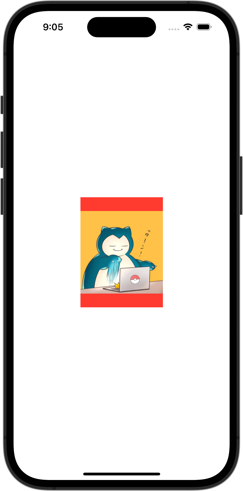

+++
title = "SwiftUIで画像をリサイズして表示する（fit）"
url = "2023-10-01"
date = "2023-10-01"
description = "SwiftUIで画像をリサイズして表示する（fit）"
tags = ["Swift", "SwiftUI"]
categories = ["SwiftUI"]
archives = "2023/10"
+++

<br>

SwiftUIで画像をリサイズして表示させる方法です。
150×200サイズに画像をリサイズして表示させています。
アスペクト比が異なる場合は余白を赤色で表示しています。



<!--more-->

**ContentView.swift**

```swift
import SwiftUI

struct ContentView: View {
    var body: some View {
        Image(.icon)
            .resizable()
            .aspectRatio(contentMode: .fit)
            .frame(width: 150, height: 200)
            .background(Color.red)
    }
}

#Preview {
    ContentView()
}
```

