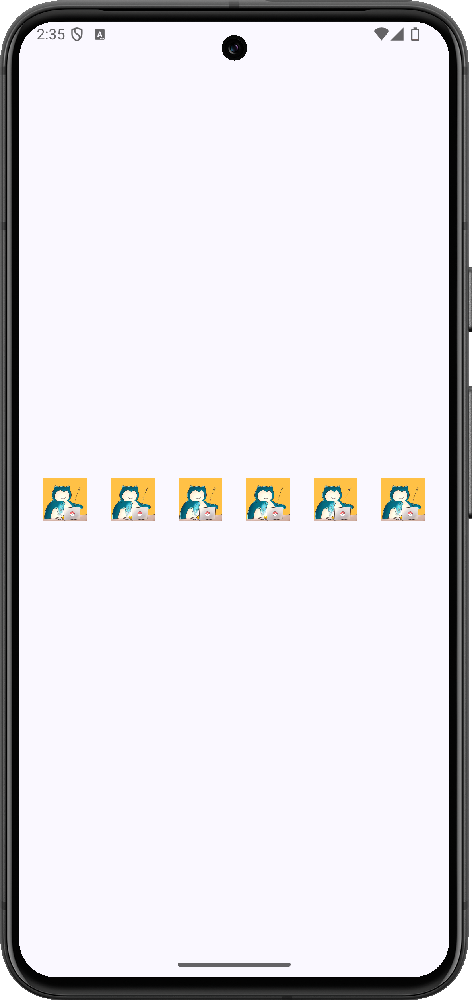

+++
title = "Jetpack Composeで画像を等間隔で横に並べる"
url = "2023-10-05-jetpack-compose-row-spacing"
date = "2023-10-05"
description = "Rowの中でSpacerに同じweightを指定し、画像の間と両端の余白を均等にします。"
summary = "Rowの中でSpacerに同じweightを指定し、画像の間と両端の余白を均等にします。"
tags = ["Android", "Jetpack Compose"]
categories = ["Jetpack Compose"]
archives = "2023/10"
+++

Rowの中でSpacerに同じweightを指定し、画像の間と両端の余白を均等にします。

<a href="screenshot.png"></a>

<!--more-->

## 実装のポイント

6枚の画像の前後に7個の`Spacer`を置き、すべてに`weight(1f)`を指定しています。画像を置いた残りの横幅を7等分するため、両端にも画像間と同じ余白ができます。画像が収まらないほど狭い画面ではサイズや枚数を調整してください。

## 準備

Android StudioのCompose対応プロジェクトで、Material 3を使用します。以下のコードではパッケージ名を`com.swiswiswift.swiswikotlin`にしています。自分のプロジェクトに合わせて変更してください。テーマは`MaterialTheme`に揃えています。

各記事は独立したサンプルです。同じプロジェクトで試す場合は、前のサンプルの`MainActivity`や`ContentView`を置き換えてください。

[サンプルの画像](snorlax.png)を`app/src/main/res/drawable/snorlax.png`に置き、`res/values/strings.xml`へ次の文字列を追加します。別の画像を使用するときは、リソース名と説明も変更してください。

```xml
<resources>
    <string name="snorlax">カビゴンの画像</string>
</resources>
```

## コード

### MainActivity.kt

[MainActivity.ktをダウンロード](MainActivity.kt)

```kotlin
package com.swiswiswift.swiswikotlin

import android.os.Bundle
import androidx.activity.ComponentActivity
import androidx.activity.compose.setContent
import androidx.activity.enableEdgeToEdge
import androidx.compose.foundation.layout.fillMaxSize
import androidx.compose.foundation.layout.padding
import androidx.compose.material3.MaterialTheme
import androidx.compose.material3.Scaffold
import androidx.compose.ui.Modifier

class MainActivity : ComponentActivity() {
    override fun onCreate(savedInstanceState: Bundle?) {
        super.onCreate(savedInstanceState)
        enableEdgeToEdge()
        setContent {
            MaterialTheme {
                Scaffold(modifier = Modifier.fillMaxSize()) { innerPadding ->
                    ContentView(innerPadding)
                }
            }
        }
    }
}
```

### ContentView.kt

[ContentView.ktをダウンロード](ContentView.kt)

```kotlin
package com.swiswiswift.swiswikotlin

import androidx.compose.foundation.Image
import androidx.compose.foundation.layout.Arrangement
import androidx.compose.foundation.layout.PaddingValues
import androidx.compose.foundation.layout.Row
import androidx.compose.foundation.layout.Spacer
import androidx.compose.foundation.layout.fillMaxSize
import androidx.compose.foundation.layout.padding
import androidx.compose.foundation.layout.size
import androidx.compose.runtime.Composable
import androidx.compose.ui.Alignment
import androidx.compose.ui.Modifier
import androidx.compose.ui.layout.ContentScale
import androidx.compose.ui.res.painterResource
import androidx.compose.ui.res.stringResource
import androidx.compose.ui.tooling.preview.Preview
import androidx.compose.ui.unit.dp
import androidx.compose.material3.MaterialTheme

@Composable
fun ContentView(innerPadding: PaddingValues = PaddingValues()) {
    Row(
        modifier = Modifier
            .fillMaxSize()
            .padding(innerPadding),
        horizontalArrangement = Arrangement.Center,
        verticalAlignment = Alignment.CenterVertically,
    ) {
        Spacer(modifier = Modifier.weight(1.0f))

        Image(
            modifier = Modifier
                .size(42.dp, 42.dp),
            painter = painterResource(id = R.drawable.snorlax),
            contentScale = ContentScale.Fit,
            contentDescription = stringResource(id = R.string.snorlax)
        )

        Spacer(modifier = Modifier.weight(1.0f))

        Image(
            modifier = Modifier
                .size(42.dp, 42.dp),
            painter = painterResource(id = R.drawable.snorlax),
            contentScale = ContentScale.Fit,
            contentDescription = stringResource(id = R.string.snorlax)
        )

        Spacer(modifier = Modifier.weight(1.0f))

        Image(
            modifier = Modifier
                .size(42.dp, 42.dp),
            painter = painterResource(id = R.drawable.snorlax),
            contentScale = ContentScale.Fit,
            contentDescription = stringResource(id = R.string.snorlax)
        )

        Spacer(modifier = Modifier.weight(1.0f))

        Image(
            modifier = Modifier
                .size(42.dp, 42.dp),
            painter = painterResource(id = R.drawable.snorlax),
            contentScale = ContentScale.Fit,
            contentDescription = stringResource(id = R.string.snorlax)
        )

        Spacer(modifier = Modifier.weight(1.0f))

        Image(
            modifier = Modifier
                .size(42.dp, 42.dp),
            painter = painterResource(id = R.drawable.snorlax),
            contentScale = ContentScale.Fit,
            contentDescription = stringResource(id = R.string.snorlax)
        )

        Spacer(modifier = Modifier.weight(1.0f))

        Image(
            modifier = Modifier
                .size(42.dp, 42.dp),
            painter = painterResource(id = R.drawable.snorlax),
            contentScale = ContentScale.Fit,
            contentDescription = stringResource(id = R.string.snorlax)
        )

        Spacer(modifier = Modifier.weight(1.0f))
    }
}

@Preview(showBackground = true)
@Composable
fun ContentViewPreview() {
    MaterialTheme {
        ContentView()
    }
}
```

## 参考

- [Android Developers: レイアウトの基本](https://developer.android.com/develop/ui/compose/layouts/basics)

## 関連記事

- [Jetpack Composeで丸い画像に枠を付ける](../2023-10-04-jetpack-compose-circle-image-border/)
- [Jetpack ComposeのNavigationBarで画面を切り替える](../2023-10-06-jetpack-compose-bottom-navigation/)
