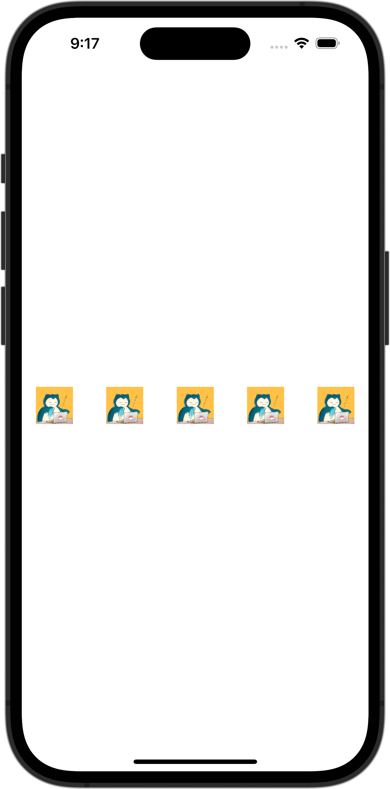

+++
title = "SwiftUIで画像を等間隔で横に並べる"
url = "2023-10-05"
date = "2023-10-05"
description = "SwiftUIで画像を等間隔で横に並べる"
tags = ["Swift", "SwiftUI"]
categories = ["SwiftUI"]
archives = "2023/10"
+++

<br>

SwiftUIで画像を等間隔で横に並べる方法です。
Spacerを使うことで等間隔にViewを並べることができます。



<!--more-->

**ContentView.swift**

```swift
import SwiftUI

struct ContentView: View {
    var body: some View {
        HStack {
            Image(.icon)
                .resizable()
                .frame(width: 42, height: 42)
            Spacer()
            Image(.icon)
                .resizable()
                .frame(width: 42, height: 42)
            Spacer()
            Image(.icon)
                .resizable()
                .frame(width: 42, height: 42)
            Spacer()
            Image(.icon)
                .resizable()
                .frame(width: 42, height: 42)
            Spacer()
            Image(.icon)
                .resizable()
                .frame(width: 42, height: 42)
        }
        .padding(16)
    }
}

#Preview {
    ContentView()
}
```

