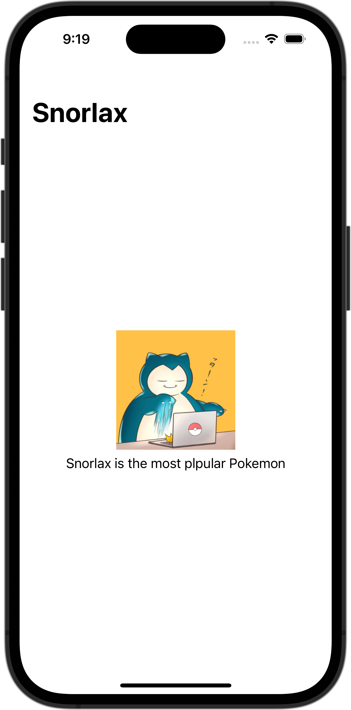

+++
title = "SwiftUIでNavigationViewを使いラージタイトルを表示する"
url = "2023-10-06"
date = "2023-10-06"
description = "SwiftUIでNavigationViewを使いラージタイトルを表示する"
tags = ["Swift", "SwiftUI"]
categories = ["SwiftUI"]
archives = "2023/10"
+++

<br>

SwiftUIでNavigationViewを使いラージタイトルを表示する方法です。
`navigationTitle` でタイトルを設定し、`navigationBarTitleDisplayMode` でサイズを指定しています。



<!--more-->

**ContentView.swift**

```swift
import SwiftUI

struct ContentView: View {
    var body: some View {
        NavigationStack {
            VStack {
                Image(.icon)
                    .resizable()
                    .frame(width: 150, height: 150)

                Text("Snorlax is the most plpular Pokemon")
            }
            .navigationBarTitleDisplayMode(.large)
            .navigationTitle("Snorlax")
        }
    }
}

#Preview {
    ContentView()
}
```

