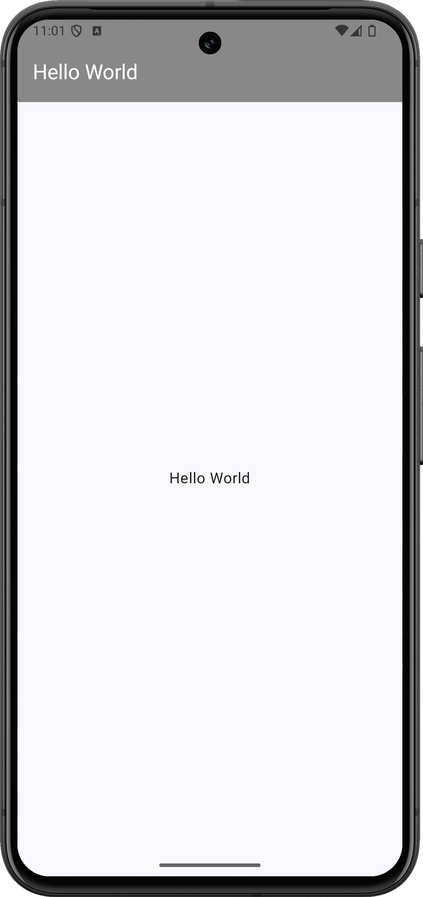

+++
title = "Jetpack ComposeでTopAppBarにタイトルを表示する"
url = "2023-10-07-jetpack-compose-top-app-bar"
date = "2023-10-07"
description = "ScaffoldのtopBarにTopAppBarを置き、画面の上部にタイトルを表示します。"
summary = "ScaffoldのtopBarにTopAppBarを置き、画面の上部にタイトルを表示します。"
tags = ["Android", "Jetpack Compose"]
categories = ["Jetpack Compose"]
archives = "2023/10"
+++

ScaffoldのtopBarにTopAppBarを置き、画面の上部にタイトルを表示します。

<a href="screenshot.png"></a>

<!--more-->

## 実装のポイント

`Scaffold`の`topBar`にバーを指定し、本文には`innerPadding`を渡します。これで本文がバーの下に隠れないように配置できます。今回は`TopAppBarDefaults.topAppBarColors`で背景をグレー、タイトルを白にしています。

## 準備

Android StudioのCompose対応プロジェクトで、Material 3を使用します。以下のコードではパッケージ名を`com.swiswiswift.swiswikotlin`にしています。自分のプロジェクトに合わせて変更してください。テーマは`MaterialTheme`に揃えています。

各記事は独立したサンプルです。同じプロジェクトで試す場合は、前のサンプルの`MainActivity`や`ContentView`を置き換えてください。

## コード

### MainActivity.kt

[MainActivity.ktをダウンロード](MainActivity.kt)

```kotlin
package com.swiswiswift.swiswikotlin

import android.os.Bundle
import androidx.activity.ComponentActivity
import androidx.activity.compose.setContent
import androidx.activity.enableEdgeToEdge
import androidx.compose.foundation.layout.Arrangement
import androidx.compose.foundation.layout.Column
import androidx.compose.foundation.layout.fillMaxSize
import androidx.compose.foundation.layout.padding
import androidx.compose.material3.ExperimentalMaterial3Api
import androidx.compose.material3.Scaffold
import androidx.compose.material3.Text
import androidx.compose.material3.TopAppBar
import androidx.compose.material3.TopAppBarDefaults
import androidx.compose.ui.Alignment
import androidx.compose.ui.Modifier
import androidx.compose.ui.graphics.Color
import androidx.compose.material3.MaterialTheme

@OptIn(ExperimentalMaterial3Api::class)

class MainActivity : ComponentActivity() {
    override fun onCreate(savedInstanceState: Bundle?) {
        super.onCreate(savedInstanceState)
        enableEdgeToEdge()
        setContent {
            MaterialTheme {
                Scaffold(
                    topBar = {
                        TopAppBar(
                            colors = TopAppBarDefaults.topAppBarColors(
                                containerColor = Color.Gray,
                                titleContentColor = Color.White,
                            ),
                            title = { Text(text = "Hello World") }
                        )
                    },
                    modifier = Modifier.fillMaxSize()
                ) { innerPadding ->
                    Column(
                        modifier = Modifier
                            .fillMaxSize()
                            .padding(innerPadding),
                        horizontalAlignment = Alignment.CenterHorizontally,
                        verticalArrangement = Arrangement.Center
                    ) {
                        Text(text = "Hello World")
                    }
                }
            }
        }
    }
}
```

## 参考

- [Android Developers: アプリバー](https://developer.android.com/develop/ui/compose/components/app-bars)

## 関連記事

- [Jetpack ComposeのNavigationBarで画面を切り替える](../2023-10-06-jetpack-compose-bottom-navigation/)
- [Jetpack Composeでボタンを押したら文字を変える](../2023-10-08-jetpack-compose-button-state/)
