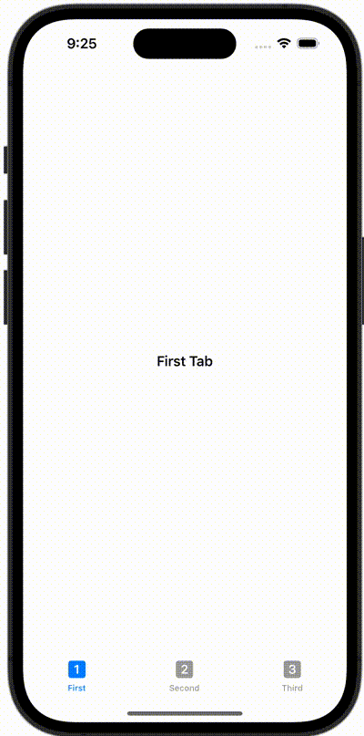

+++
title = "SwiftUIでTabViewを使って画面を切り替える"
url = "2023-10-08"
date = "2023-10-08"
description = "SwiftUIでTabViewを使って画面を切り替える"
tags = ["Swift", "SwiftUI"]
categories = ["SwiftUI"]
archives = "2023/10"
+++

<br>

SwiftUIでTabViewを使って画面を切り替える方法です。



<!--more-->

**ContentView.swift**

```swift
import SwiftUI

struct ContentView: View {
    var body: some View {
        TabView {
            Text("First Tab")
                .tabItem {
                    Image(systemName: "1.square.fill")
                    Text("First")
                }
            Text("Second Tab")
                .tabItem {
                    Image(systemName: "2.square.fill")
                    Text("Second")
                }
            Text("Third Tab")
                .tabItem {
                    Image(systemName: "3.square.fill")
                    Text("Third")
                }
        }
        .font(.headline)
    }
}

#Preview {
    ContentView()
}
```

