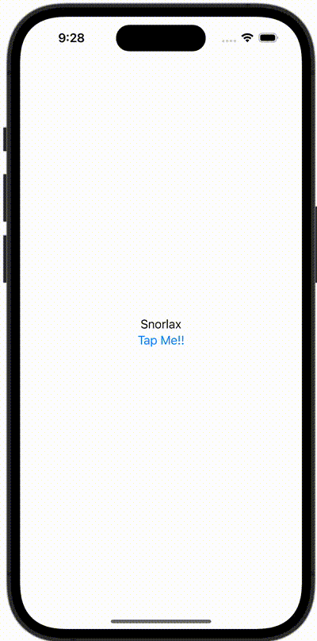

+++
title = "SwiftUIでButtonが押されたら文字を変える"
url = "2023-10-09"
date = "2023-10-09"
description = "SwiftUIでButtonが押されたら文字を変える"
tags = ["Swift", "SwiftUI"]
categories = ["SwiftUI"]
archives = "2023/10"
+++

<br>

SwiftUIでButtonが押されたら文字を変える方法です。
`@State` が付与された変数を変えることで View 変えることができます。



<!--more-->

**ContentView.swift**

```swift
import SwiftUI

struct ContentView: View {
    @State var text = "Snorlax"

    var body: some View {
        VStack {
            Text(text)
            Button(action: {
                text = "Forever"
            }) {
                Text("Tap Me!!")
            }
        }
    }
}
```

