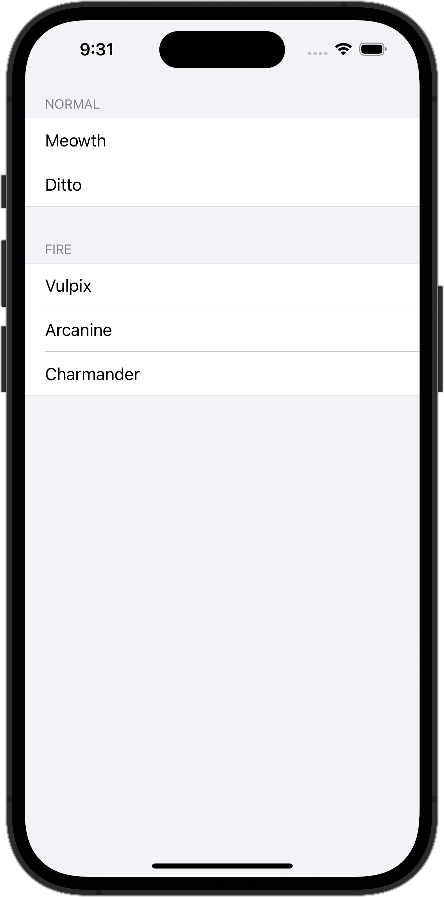

+++
title = "SwiftUIでListを使ってセクションごとに表示する"
url = "2023-10-10"
date = "2023-10-10"
description = "SwiftUIでListを使ってセクションごとに表示する"
tags = ["Swift", "SwiftUI"]
categories = ["SwiftUI"]
archives = "2023/10"
+++

<br>

SwiftUIでListを使ってセクションごとに表示する方法です。
Listの `listStyle` を指定して表示方法を変えています。



<!--more-->

**ContentView.swift**

```swift
import SwiftUI

struct ContentView: View {
    var body: some View {
        List {
            Section("Normal") {
                Text("Meowth")
                Text("Ditto")
            }

            Section("Fire") {
                Text("Vulpix")
                Text("Arcanine")
                Text("Charmander")
            }
        }
        .listStyle(.grouped)
    }
}

#Preview {
    ContentView()
}
```

