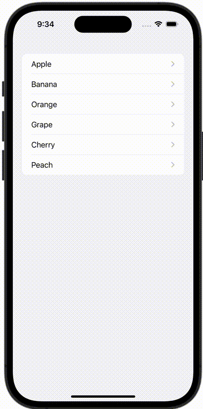

+++
title = "SwiftUIで画面遷移時に値を渡す"
url = "2023-10-11"
date = "2023-10-11"
description = "SwiftUIで画面遷移時に値を渡す"
tags = ["Swift", "SwiftUI"]
categories = ["SwiftUI"]
archives = "2023/10"
+++

<br>

SwiftUIで画面遷移時に値を渡す方法です。
遷移先の画面に文字列を渡しています。



<!--more-->

**ContentView.swift**

```swift
import SwiftUI

struct ContentView: View {
    let fruits = ["Apple", "Banana", "Orange", "Grape", "Cherry", "Peach"]

    var body: some View {
        NavigationView {
            List(fruits, id: \.self) { fruit in
                NavigationLink(destination: SecondView(fruit: fruit)) {
                    Text(fruit)
                }
            }
        }
    }
}

#Preview {
    ContentView()
}
```


**SecondView.swift**

```swift
import SwiftUI

struct SecondView: View {
    let fruit: String

    var body: some View {
        Text(fruit)
    }
}

#Preview {
    SecondView(fruit: "Apple")
}
```

