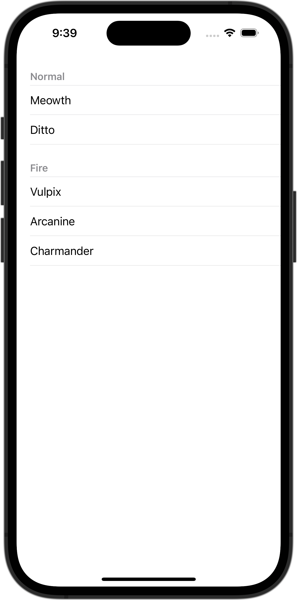

+++
title = "SwiftUIでListのスタイルを変更する(plain)"
url = "2023-10-13"
date = "2023-10-13"
description = "SwiftUIでListのスタイルを変更する(plain)"
tags = ["Swift", "SwiftUI"]
categories = ["SwiftUI"]
archives = "2023/10"
+++

<br>

SwiftUIでListのスタイルを変更する方法です。
`listStyle` に `plain` を設定しています。



<!--more-->

**ContentView.swift**

```swift
import SwiftUI

struct ContentView: View {
    var body: some View {
        List {
            Section("Normal") {
                Text("Meowth")
                Text("Ditto")
            }

            Section("Fire") {
                Text("Vulpix")
                Text("Arcanine")
                Text("Charmander")
            }
        }
        .listStyle(.plain)
    }
}

#Preview {
    ContentView()
}
```

