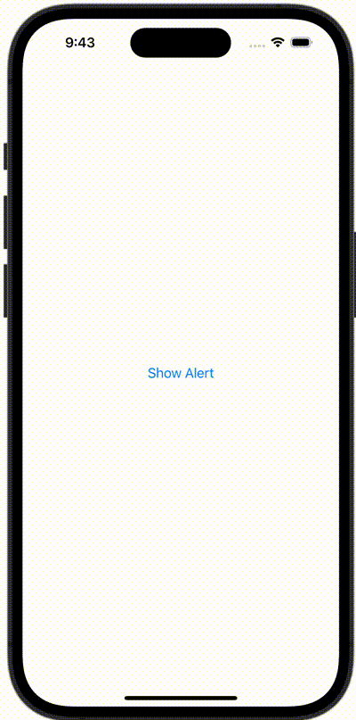

+++
title = "SwiftUIでAlertを表示する"
url = "2023-10-14"
date = "2023-10-14"
description = "SwiftUIでAlertを表示する"
tags = ["Swift", "SwiftUI"]
categories = ["SwiftUI"]
archives = "2023/10"
+++

<br>

SwiftUIでAlertを表示する方法です。
`showingAlert` 変数を `true` にすることでアラートを表示することができます。



<!--more-->

**ContentView.swift**

```swift
import SwiftUI

struct ContentView: View {
    @State var showingAlert = false

    var body: some View {
        VStack {
            Button {
                showingAlert = true
            } label: {
                Text("Show Alert")
            }
        }
        .alert("Alert Title", isPresented: $showingAlert) {
            Button("Done", role: .none) {
                print("Done")
            }
            Button("Cancel", role: .cancel) {
                print("Cancel")
            }
        } message: {
            Text("Message")
        }
    }
}

#Preview {
    ContentView()
}
```

